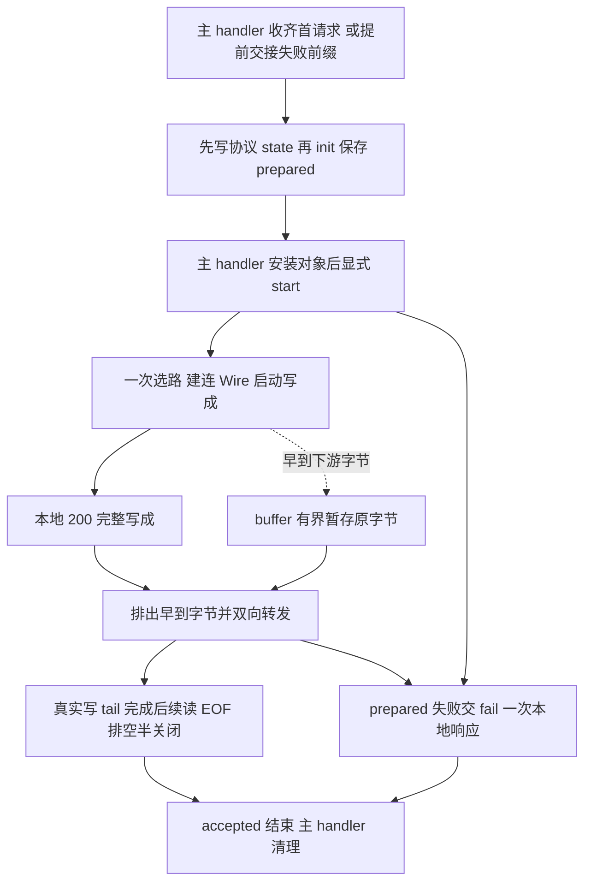

# HttpConnectConnection Product Design

更新日期：2026-10-14。状态：**六成员目标设计；现有 Swift 尚未迁移，不代表上线验收通过**。
行为基线：[HTTP SPEC](../HTTP_PROXY_SPEC.md)、[Wire SPEC](../WIRES_SPEC.md)、[MODELS SPEC](../MODELS_SPEC.md)。

## Context

`MagentTCPConnection` 探测协议并收齐 HTTP 首请求，构造时交付包含同批余量的全部原始字节；
已确定非法或截断时提前交付前缀。主 handler 仅在头完整时做一次局部 NIO 头解码及长度定界，
不构造 HttpProtocol 或发送本地响应；不持久保存 decoder 或解码 body。
本类 init 纯解析并保存结果；主 handler 安装完成后显式调用 [ProxyConnection.start](MagentTCPConnection-DESIGN.md#共享协议proxyconnection)，
再开始本地响应、Core 选路、Wire 启动及转发。upstream 此后只接收新字节，不重放首请求。
本类借用 accepted Channel，拥有唯一 `wireChannel` 和本连接独占的可选 `wire`；DIRECT 无 Wire。
accepted 的最终关闭属于主 handler；`closeConnection(error:)` 只处理本类状态和下游资源。
全部状态在 accepted EventLoop 访问，不新增 Task、线程、会话包装或 Swift 文件。

CONNECT 仅支持无体 authority-form。完整请求至完整 200 写成之间拒绝客户端业务；
随后所有业务均为不透明隧道字节，不再解析 HTTP 或重新选路。

## Contract

### 类型、六个实例成员及状态

```swift
internal final class HttpConnectConnection: ChannelInboundHandler, ProxyConnection, @unchecked Sendable {
    typealias InboundIn = ByteBuffer
    private enum Direction { case upstream, downstream }
    private enum Transfer {
        case reading
        case writing(tail: EventLoopFuture<Void>, pendingBytes: Int)
        case draining(tail: EventLoopFuture<Void>, pendingBytes: Int)
        case ended
    }
    private enum State {
        case prepared(version: HTTPVersion, result: Result<HttpProtocol, Error>)
        case opening(version: HTTPVersion, upstream: Transfer, downstream: Transfer)
        case replying(upstream: Transfer, downstream: Transfer)
        case relay(upstream: Transfer, downstream: Transfer)
        case failing
        case finishing(tail: EventLoopFuture<Void>)
        case closed
    }
    private let proxyChannel: Channel
    private let core: MagentCore
    private var state: State
    private var buffer: ByteBuffer
    private var wireChannel: Channel? = nil
    private var wire: Wire? = nil
}
```

这是完整实例成员集合：**6 个成员、0 个 Boolean 成员**。不增加静态/计算属性、位掩码、
上下文对象或附加存储绕过限制。状态中只保存当前阶段必需的数据，具体字段列在下表；
不添加独立请求、错误、codec、计时器字段或旧布尔标记。原始首请求只属于 init 局部参数，构造结束即释放。

#### 类成员

| 成员 | 用途、初始化、变更入口与生命周期 |
| --- | --- |
| `proxyChannel: Channel` | init 注入的 accepted 强引用，连接内不替换；本类只借用，其最终关闭属于主 handler，下游使用其 EventLoop。 |
| `core: MagentCore` | init 注入的所属运行周期 Core 强引用，连接内不替换；供选路、建连及取得默认期限使用。 |
| `state: State` | init 置 prepared；start 成功分支进入 opening，失败分支交 fail。启动成功进入 replying，200 真正写成进入 relay；fail 抢占 failing；closeConnection 进入 closed 或受限 finishing，终态不复活。 |
| `buffer: ByteBuffer` | init 用 accepted allocator 建空缓冲，只保存启动/回复前早到的下游原字节；不保存请求。屏障通过后取走并释放，closeConnection 清空。 |
| `wireChannel: Channel?` | 初值 nil；openTunnel 建连成功后赋值，迟到 Channel 在赋值前检查状态，不符合阶段则立即关闭。cleanup 先取空再关闭资源。 |
| `wire: Wire?` | 初值 nil；openTunnel 一次选路后赋值，DIRECT 保持 nil；同一 Wire 决定端点、超时和流状态。cleanup 取空并释放。 |

#### 状态数据

下列字段属于已声明的 State 或 Transfer，不是额外的类成员；无数据的状态见上述 enum 声明。

| 字段 | 所属状态 | 用途、变更入口与生命周期 |
| --- | --- | --- |
| `version: HTTPVersion` | State.prepared、State.opening | 本地回复版本；正常构造取支持的入站版本，否则 HTTP/1.1。initialError 非 nil 时取受支持的 initialVersion，否则 HTTP/1.1；进入 replying 前封闭失败响应资格。 |
| `result: Result<HttpProtocol, Error>` | State.prepared | init 同步局部解码、最多构造一次 HttpProtocol，确认 CONNECT 无体且无余量；成功只保存模型，失败保存原 Error。start 取走结果后释放，重复 start 不重复启动。 |
| `upstream: Transfer` | State.opening、State.replying、State.relay | 客户端→下游的传输状态；建立与回复阶段只记录输入 EOF，relay 阶段按真实写入和 EOF 推进。 |
| `downstream: Transfer` | State.opening、State.replying、State.relay | 下游→客户端的传输状态；建立与回复阶段只记录输入 EOF，relay 阶段按真实写入和 EOF 推进。 |
| `tail: EventLoopFuture<Void>` | Transfer.writing、Transfer.draining | 尚未完成的真实网络写尾；writing 可有序追加，draining 已见该方向 EOF，必须等待同一尾链排空。 |
| `pendingBytes: Int` | Transfer.writing、Transfer.draining | 未完成批次的完整容量预留；追加前预留，真实写完成后只释放本批占用，全部清零才结束等待。 |
| `tail: EventLoopFuture<Void>` | State.finishing | accepted 已失效后的原上行排空屏障，只能沿既有链完成；不再接收输入、建连或启动新的业务。 |

opening 和 replying 的 Transfer 仅允许 reading/ended，分别表示未见/已见输入 EOF；
建立/200 的真实写屏障属于唯一建立链局部值，不保存为业务 tail。
relay 的 ended 表示输入已 EOF 且数据已排空，不单独表示 FIN 已提交。

reading 遇业务进入 writing，遇 EOF 完成适用校验后直接 ended；不为零业务制造空 Future。
writing 可追加到同一有界 tail 或进入 draining。
写完成扣减本批容量预留，仅最新 tail 清零后才能恢复 reading；draining 清零后先切 ended。
新进入 ended 时若反向仍 reading/writing，提交对应输出 FIN；反向 draining 时暂缓，双 ended 时整体关闭。
先更新状态再执行 I/O，避免同步 channelInactive 重入；FIN 回调只传播失败，不重复发 FIN。
启动门槛前只记录输入 ended；门槛通过后先将早到 buffer 纳入 relay 写链，再按所记录 EOF
推进 draining、校验 Wire 尾部和关闭，不把建立/回复阶段的 ended 当成 relay 已经排空。

### 完整方法声明

#### 非 private 方法

```swift
internal init(proxyChannel: Channel, core: MagentCore, initialData: ByteBuffer, initialError: Error? = nil, initialVersion: HTTPVersion = .http1_1)
internal func start(context: ChannelHandlerContext)
internal func upstream(context: ChannelHandlerContext, data: NIOAny)
internal func proxyInputClosed(context: ChannelHandlerContext)
internal func closeConnection(error: Error?)
internal func channelRead(context: ChannelHandlerContext, data: NIOAny)
internal func userInboundEventTriggered(context: ChannelHandlerContext, event: Any)
internal func channelInactive(context: ChannelHandlerContext)
internal func errorCaught(context: ChannelHandlerContext, error: Error)
internal static func decodeRequest(_ data: ByteBuffer, on channel: Channel) throws -> HTTPRequestPartsHandler.Output
internal static func encodeResponse(version: HTTPVersion, status: HTTPResponseStatus, on channel: Channel) throws -> ByteBuffer
```

| 方法 | 调用方与职责 |
| --- | --- |
| init | 主 handler 交付首请求或失败前缀；纯同步解析并保存 prepared，不 read/write、选路、建连、投递启动任务或向 accepted 上报错误。initialError 非 nil 时保留同一 Error，不重复解码/建模。 |
| start | 主 handler 先写协议 state，再 init，保存对象并清空首请求缓冲后调用一次；取出 prepared，成功开始 openTunnel，失败交 fail；不使用空 upstream 隐式启动。 |
| upstream / closeConnection | 前者只接收构造后的新字节，完整 200 前严格拒绝业务；后者由 accepted owner 通知结束，不关闭 accepted、不回复、不重复上报。 |
| channelRead | 下游回调交付业务，由 relay/write 完成透传或编解码、实际网络写入与流控。 |
| proxyInputClosed / userInboundEventTriggered / channelInactive | 将首次 EOF 交 finish 推进对应 Transfer；重复事件幂等。正常 EOF 校验 Wire，一次排空和半关闭；全关不能假装成功排空。 |
| errorCaught | 下游原始错误汇入 fail，由统一失败边界决定回复并上报主 handler。 |
| decodeRequest / encodeResponse | 两 HTTP Connection 共用的局部 codec 操作；不持有连接资源，不选择错误策略；原错经 Output.failed 或声明的 throws 返回，不包装。 |

#### private 方法

```swift
private func openTunnel(request: HttpProtocol) -> EventLoopFuture<Void>
private func relay(_ data: ByteBuffer, direction: Direction) throws
private func write(_ data: ByteBuffer, direction: Direction) -> EventLoopFuture<Void>
private func finish(_ direction: Direction) throws
private func fail(_ error: Error)
```

| 方法 | 调用方与职责 |
| --- | --- |
| openTunnel | start 取出合法模型后调用；一次选路、拨号、Wire start 和实际启动写，随后编码并实际写完整 200。建立链持有本次目标等局部值，迟到回调检查阶段。 |
| relay / write | 下游回调或 upstream 交付业务；DIRECT 透传，PROXY 有界编解码。write 返回实际网络 Future，按方向串联、计数和恢复读许可。 |
| finish | EOF 入口调用；首次 EOF 推进对应 Transfer，重复事件幂等。正常 EOF 校验 Wire，一次排空和半关闭；全关不能假装成功排空。 |
| fail | 所有同步/异步失败汇入此边界；按原阶段决定本地回复，先占 failing，再在唯一回复链保留原 Error 并上报主 handler。 |

### 共用 HTTP codec 适配器

以下类型仍位于现有 `HttpConnectConnection.swift`。它们只收集一次同步编解码的结果，不是新的
Connection owner；不持有 Channel、Core、Wire、Connection、Future 或业务生命周期。
两个适配器均默认无参构造，只收集本次局部 codec 操作，不跨批恢复已解出的头。
类型和成员声明如下，方法按访问级别单列。

```swift
internal final class HTTPRequestPartsHandler: ChannelInboundHandler, RemovableChannelHandler, @unchecked Sendable {
    typealias InboundIn = HTTPServerRequestPart
    internal enum Output {
        case empty
        case head(HTTPRequestHead, body: ByteBuffer)
        case complete(HTTPRequestHead, body: ByteBuffer)
        case failed(head: HTTPRequestHead?, error: Error)
    }
    internal private(set) var output: Output = .empty
}
internal final class HTTPEncodedBytesHandler: ChannelOutboundHandler, RemovableChannelHandler, @unchecked Sendable {
    typealias OutboundIn = IOData
    internal private(set) var output: Result<ByteBuffer, Error>? = nil
}
```

#### HTTPRequestPartsHandler 类成员

| 成员 | 用途、初始化、变更入口与生命周期 |
| --- | --- |
| `output: Output` | 初值 .empty；channelRead 收集当前局部解码结果，errorCaught 保留首个原始错误；当前同步 codec 操作结束后随适配器释放，不跨网络事件保存。 |

#### HTTPEncodedBytesHandler 类成员

| 成员 | 用途、初始化、变更入口与生命周期 |
| --- | --- |
| `output: Result<ByteBuffer, Error>?` | 初值 nil；write 聚合当前局部编码结果或保存原始错误；编码完成并卸载适配器后释放，不作为真实网络写屏障。 |

#### 非 private 方法

```swift
// HTTPRequestPartsHandler
internal func channelRead(context: ChannelHandlerContext, data: NIOAny)
internal func errorCaught(context: ChannelHandlerContext, error: Error)
// HTTPEncodedBytesHandler
internal func write(context: ChannelHandlerContext, data: NIOAny, promise: EventLoopPromise<Void>?)
```

| 所属类型 / 方法 | 调用方与职责 |
| --- | --- |
| HTTPRequestPartsHandler.channelRead | NIO 解码事件；严格接收唯一 head、零或多段 body、唯一 end(nil)，重复、乱序、trailer、超限转 failed；请求结果最多 64 KiB。 |
| HTTPRequestPartsHandler.errorCaught | 保留首个原始 NIO 错误及已解出的 head；不包装错误，不保存 trailers/ended/failure 独立标志。 |
| HTTPEncodedBytesHandler.write | NIO 编码输出；仅聚合有界 ByteBuffer，不接受 FileRegion，编码结果最多 128 KiB；promise 表示编码完成，不能替代真实网络写屏障。 |

#### private 方法

两个适配器均无 private 方法。

decodeRequest 同时供主 handler 的一次完整头部探测，以及两个子 init 的完整请求验收使用。
每次在 accepted EventLoop 创建局部 HTTPRequestDecoder、ByteToMessageHandler 和默认请求适配器，
由 NIO 配对 decoder 生命周期；不伪造 EOF，头已完整但 body 未送入时允许返回 head。
解码错误经 Output.failed 保留同次已经解出的 head 和首个原 Error，不包装、不另行路由，
不向 accepted owner 发错误或生命周期事件。返回 empty/head/complete 或 failed，由调用方决定是否继续等待。
codec、context 和 collector 仅存活于当前同步调用，结束即卸载释放，不跨网络事件或逐批重解累计前缀。
编码同样局部使用真实 NIO encoder；临时适配器默认同步移除，编码完成并卸载后才向 Channel 写字节。
encodeResponse 的 200 无 CL/TE/Connection/body；错误带 Content-Length:0、Connection:close。

### 首请求交接与构造解析

主 handler 收到完整且原始 UTF-8 合法的头后，仅调用一次 decodeRequest 解码头部。
CONNECT 的正常 requestLength 为头长；主只用该长度判断可交接，不保存 head/decoder 或解码 body。
初始缓冲不丢前缀，initialData 是 0..<writerIndex 全部字节，包含同批余量。
Expect、TE/chunked、Upgrade、Trailer、CONNECT 非零 body、长度超限、语法错或 EOF 截断可提前交接，
不能等待 Expect 客户端继续发送 body。非法原始头部 UTF-8 也立即交前缀，由 init 校验并保存失败。
主只选择交接时机；语义错误由 init 校验，头部 codec 已产生的首个原 Error 通过 initialError 原样交接，
initialVersion 从同次 Output.failed 的 head 取得支持版本，否则 HTTP/1.1，不为版本新增持久状态。
确定总量超限时最多保留 64 KiB+1 的证据前缀，init 必须拒绝，不得截成合法 64 KiB。

initialError 非 nil 时，init 直接保存同一错误及受支持的 initialVersion，不解码、不建模；
正常路径忽略 initialVersion，先检查总量及原始头部严格 UTF-8，再局部 NIO 解码并取支持版本。
随后唯一构造 HttpProtocol；对于 head 尚无 end 的前缀，先让模型识别 Expect 等不支持特征，
再把剩余不完整情况判为截断。成功必须为 CONNECT、准确完整 end(nil)、空 body，且原始总长度
恰为首个头边界，拒绝所有额外字节，包括 NIO 已消耗但尚未形成第二个 head 的尾部。
模型/语法/容量错误都保存到 prepared；构造中禁止 fail 或任何 I/O，首次本地失败响应只由 start 发起。
主 handler 的顺序是先写协议 state → init → 保存对象并清空首请求缓冲 → start，
再交此前观察到的 EOF；prepared 不另存 EOF 标记。
关闭若先于 start 则直接释放 prepared；重复 start 或 closed 后的 start 不重新回复或建连。
这些共享 codec 已承担复用；不再增加子层增量请求方法、基类或会话容器。

## Core Logic



请求总量限 64 KiB；init 拒绝同批余量，upstream 拒绝成功前的新业务。start 后只保留观察客户端提前数据及
FIN 的必要观察许可；不主动读取下游。NIO 的 readEOF0 可能在 autoRead=false 时继续交付数据，
因此不以“未发读许可”证明“不会收到字节”：早到下游原字节先按 64 KiB 总上限追加到唯一 buffer。
200 写成后才 decode/转发这些字节；此前 EOF 也必须经过这条启动及回复屏障。

业务通常按 read→write→read。已获许可或 EOF drain 的额外输入仍先检查当前 pendingBytes，
追加到有界 tail，不能简单因 writing 状态拒绝合法输入；超限统一失败。每批输入最多 64 KiB。
pendingBytes 是整批容量预留，包含等待链持有的输入、分段副本及最坏输出的 Data/Channel 两份；
每方向预算 512 KiB，早到 buffer 及操作局部捕获也占用此预算，实际网络写完成才释放本批预留。
Wire 每次输入最多 16 KiB；当前 Shadowsocks 数学上界为 start 325、encode 16,452、decode 32 KiB。
整批编码输出上界为 65,808 字节，解码保守上界为 128 KiB；调用前先预留，不在 Wire 分配后补检查。
预算不包括 Swift/NIO 元数据和 Wire 内部状态；后端强制边界仍待验收，不是进程 RSS 承诺。

两向 EOF 按上述状态协调排空与输出 FIN；两向 ended 后才请求 accepted 整体结束。若 NIO 因既有输出 FIN
在后续输入 EOF 时直接触发 accepted inactive，closeConnection(nil) 仅在下游 EOF 已验证、响应已排空
并提交 accepted 输出 FIN、上行仍为 writing 时进入 finishing，沿原链最多排空 core.defaultTimeout。
完成、失败或到期由本次唯一局部收尾回调直接置 closed、取空并关闭下游，不再次调用 closeConnection(nil)。
finishing 中重复 nil 幂等，非 nil 错误立即终止；这是 nil 结束的有限例外，不能区分 runtime 关闭原因。
其余 cleanup 先 closed，再取空并关闭资源。建立链的操作局部 Scheduled 覆盖拨号、启动及完整 200，
使用 Wire timeout 或 DIRECT 的 Core timeout；链完成或 accepted 关闭取消。失败回复使用 Core timeout，
完成、写失败或到期只上报原始首因一次。finishing 计时器不能因 accepted 已关闭立即取消；不新增计时器成员。

## Corners

| 场景 | 必须结果 |
| --- | --- |
| 任意首请求分片、非法 UTF-8、body、trailer、同批余量 | 分片由主 handler 定界；init 局部 NIO + 唯一模型校验，非法不出站；CONNECT CL:0 按模型允许。 |
| 提前失败、Expect 等待、超限证据、构造期间关闭 | 不等待不可能完成的 body；原错误保留在 prepared，安装后 start 才回复；关闭先发生则不启动。 |
| 启动失败、200 部分写后失败 | opening 可按 SPEC 回复；replying 起只上报原错，禁止追加第二个响应。 |
| 零业务 FIN、早到下游数据+FIN、并发双 FIN | 启动/200、Wire 尾部与真实写 tail 屏障完整；数据不能被半关闭截断。 |
| 慢写、EOF drain 持续交付、迟到建连 | 分配前按总量限额；无无限队列、无复活、无双重错误上报。 |
| 错误回复本身失败、重复 cleanup | 原始首因只由唯一 fail 链上报；closed 重入无副作用。 |

按 [HTTP 验收](../HTTP_PROXY_SPEC.md#s28)及 [Wire 验收](../WIRES_SPEC.md#验收)验证。
本轮只改设计；后续迁移需成员/方法合同检查、包级 build/严格并发 build、ConnectionTests、全量测试及格式检查。
模型迁移和真实 Wire 容量边界未通过前，局部夹具验证不能作为完整上线证据。
