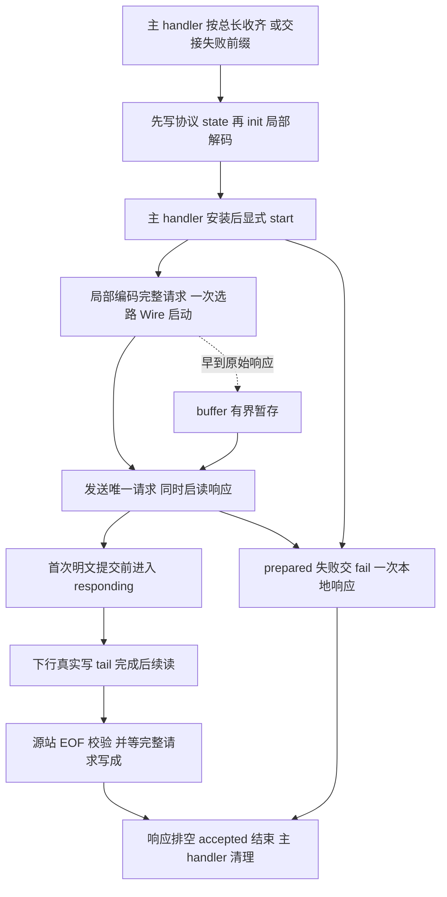

# HttpForwardConnection Product Design

更新日期：2026-10-13。状态：**六成员目标设计；现有 Swift 尚未迁移，不代表上线验收通过**。
行为基线：[HTTP SPEC](../HTTP_PROXY_SPEC.md)、[Wire SPEC](../WIRES_SPEC.md)、[MODELS SPEC](../MODELS_SPEC.md)。

## Context

主 handler 探测协议，头完整后做一次局部 NIO 头解码，再按总长度等待 Content-Length body；
构造时交付全部原始字节及同批余量，已知非法或截断则提前交接前缀。本类 init 纯解析并唯一构造
HttpProtocol，保存结果；安装完成后的显式 start 才发送请求、回复失败或创建下游。
本类借用 accepted Channel，拥有唯一 TCP 下游及独占的可选 Wire；DIRECT 不创建 Wire。
[ProxyConnection](MagentTCPConnection-DESIGN.md#共享协议proxyconnection)增加明确的 start 入口；upstream 只接收构造后的新字节，
`closeConnection(error:)` 只处理下游，accepted 的最终关闭和原始错误收尾属于主 handler。
所有状态在 accepted EventLoop 上访问，不增加 Task、线程、会话包装或 Swift 文件。

仅接收无体或单一 Content-Length 的一个请求，收齐后才建连。拒绝 TE/chunked、Trailer、Expect、
Upgrade、流水线和后续 keep-alive 请求。源站响应为不透明字节，不解析状态或 framing；
第一批源站明文字节提交 accepted 写入前即封闭本地错误响应资格。

## Contract

### 类型、六个实例成员及状态

```swift
internal final class HttpForwardConnection: ChannelInboundHandler, ProxyConnection, @unchecked Sendable {
    typealias InboundIn = ByteBuffer
    private enum Direction { case upstream, downstream }
    private enum Transfer {
        case reading
        case writing(tail: EventLoopFuture<Void>, pendingBytes: Int)
        case draining(tail: EventLoopFuture<Void>, pendingBytes: Int)
        case ended
    }
    private enum State {
        case prepared(version: HTTPVersion, result: Result<(request: HttpProtocol, body: ByteBuffer), Error>)
        case opening(version: HTTPVersion, upstream: Transfer, downstream: Transfer)
        case awaitingResponse(version: HTTPVersion, upstream: Transfer, downstream: Transfer)
        case responding(upstream: Transfer, downstream: Transfer)
        case failing
        case closed
    }
    private let proxyChannel: Channel
    private let core: MagentCore
    private var state: State
    private var buffer: ByteBuffer
    private var wireChannel: Channel? = nil
    private var wire: Wire? = nil
}
```

这是完整实例成员集合：**6 个成员、0 个 Boolean 成员**。无静态/计算属性、位掩码或附加存储。
关联值也是完整合同；prepared 只短暂保存一次解析结果或原 Error，两向 Transfer 只表示实际传输。
不将旧字段集合藏入 State、codec、闭包共享盒子或新 owner。请求发送完成及响应资格由阶段和上行 tail 推导。
首请求原字节只属于 init 局部参数，不再保存增量请求状态、扫描位置或完整请求副本。

| 成员 / 关联值 | 初始化、变更入口与生命周期 |
| --- | --- |
| `proxyChannel` / `core` | init 注入强引用，连接内不替换；下游与 accepted 共用 EventLoop。 |
| `buffer` | init 创建空 ByteBuffer，只保存 Wire 启动前早到的下游原字节；不保存请求或 prepared.body 副本。启动通过后取走并释放，cleanup 清空。 |
| `state` | init 置 prepared；start 成功分支进入 opening，失败分支交 fail。Wire 启动写成进入 awaitingResponse，首次提交响应前切 responding；fail 抢占 failing，cleanup 切 closed，禁止回退。 |
| `prepared.result` | init 保存合法模型和唯一 body，或原始 Error。start 取出成功值移交唯一建立/发送链，随后释放阶段关联值；写成或失败后局部 body 也释放，不在 buffer 留副本。 |
| `version` | 正常构造取支持的入站版本，否则 HTTP/1.1；initialError 非 nil 时取受支持的 initialVersion，否则 HTTP/1.1。prepared/opening/awaitingResponse 保存错误响应所需版本，responding 不再保留。 |
| `Transfer` | opening 仅 reading/ended 记录输入 EOF，不表示请求已写成。awaitingResponse/responding 遵守 [CONNECT 传输约束](HttpConnectConnection-DESIGN.md#类型六个实例成员及状态)；上行 tail 覆盖唯一请求的 head/body/end 真正写成，下行 tail 覆盖真实 accepted 写入。 |
| `wireChannel` / `wire` | openOutbound 一次选路后赋值；迟到 Channel 先验证阶段再接受，否则关闭。closeConnection 先 closed、取空再关闭；下游回调不得重复上报。 |

主 handler 在构造前收齐请求或判定截断，先安装并 start，再交此前观察到的 EOF；子层不续收请求 body。
opening 的客户端 FIN 只记 ended；启动后的 FIN 将上行切 draining，等待整个请求真实写成。
客户端保持输入开放时，上行写完回到 reading，仅用来发现禁止的后续数据和 FIN，不支持第二个请求。
源站响应可与唯一请求的在途写同时存在，因此 awaitingResponse/responding 都保存两个独立 Transfer。

### 完整方法声明

#### 非 private 方法

```swift
internal init(proxyChannel: Channel, core: MagentCore, initialData: ByteBuffer, initialError: Error? = nil, initialVersion: HTTPVersion = .http1_1)
internal func start(context: ChannelHandlerContext)
internal func upstream(context: ChannelHandlerContext, data: NIOAny)
internal func proxyInputClosed(context: ChannelHandlerContext)
internal func closeConnection(error: Error?)
internal func channelRead(context: ChannelHandlerContext, data: NIOAny)
internal func userInboundEventTriggered(context: ChannelHandlerContext, event: Any)
internal func channelInactive(context: ChannelHandlerContext)
internal func errorCaught(context: ChannelHandlerContext, error: Error)
```

| 方法 | 调用方与职责 |
| --- | --- |
| init | 主 handler 交付完整首请求或失败前缀；纯同步局部解码、唯一模型构造及 body 验收，保存 prepared。initialError 非 nil 时直接保存同一 Error，不重解码/建模；构造不触发 I/O、选路或错误上报。 |
| start | 主 handler 先写协议 state，再 init，保存对象并清空首请求缓冲后显式调用；成功值交 openOutbound，失败交 fail。取走 prepared 后重复调用无操作，不用空 upstream 激活。 |
| upstream / closeConnection | 前者只接收后续字节，任意额外请求数据均失败；后者只清理下游，不关闭 accepted 或重复报错。 |
| channelRead | 下游输入交 relayRemote/write 解码或透传，以真实写 Future 完成限额、串联和续读。 |
| proxyInputClosed / userInboundEventTriggered / channelInactive | 将 EOF 交 finish 处理 Wire 尾部、真实写排空与半关闭；源站响应结束也必须等待完整请求写成后才结束 accepted。 |
| errorCaught | 下游原始错误交 fail，由统一失败边界保留首因、选择适用回复并上报 accepted pipeline。 |

#### private 方法

```swift
private func openOutbound(request: HttpProtocol, body: ByteBuffer) -> EventLoopFuture<Void>
private func encodeRequest(head: HTTPRequestHead, body: ByteBuffer) throws -> ByteBuffer
private func relayRemote(_ data: ByteBuffer) throws
private func write(_ data: ByteBuffer, direction: Direction) -> EventLoopFuture<Void>
private func finish(_ direction: Direction) throws
private func fail(_ error: Error)
```

| 方法 | 调用方与职责 |
| --- | --- |
| openOutbound / encodeRequest | start 交付完整合法模型及 body；局部 NIO 编码唯一 head/body/end，一次选路和 Wire 启动，顺序写出完整请求，返回真实请求写完成 Future。 |
| relayRemote / write | 下游输入解码或透传；首次非空明文提交前切 responding。按真实写 Future 限额、串联和续读；空解码不算响应开始或 EOF。 |
| finish | EOF 入口调用；处理 Wire 尾部、真实写排空与半关闭；源站响应结束也必须等待完整请求写成后才结束 accepted。 |
| fail | 统一保留首因；先占 failing，再由唯一局部链完成可用的错误响应并将原 Error 上报 accepted pipeline。 |

共用 [CONNECT 中的 HTTP codec 完整合同](HttpConnectConnection-DESIGN.md#共用-http-codec-适配器)：
`HTTPRequestPartsHandler`、`HTTPEncodedBytesHandler`、`HttpConnectConnection.decodeRequest` 和
`HttpConnectConnection.encodeResponse`；不得复制适配器或添加长期 codec/context 成员。
encodeRequest 在本次同步操作内创建真实 HTTPRequestEncoder，按 head/body/end 编码，收集结果后
卸载临时适配器，再交给真实网络写链。编码 Future 或适配器 promise 不能代替请求已发送。

### 首请求交接与构造解析

主 handler 只在完整且原始 UTF-8 合法的头首次到齐时，用共用 decodeRequest 解码一次头部。
从 NIO head 的唯一 Content-Length 得 body 长 L，原始头长为 H；先按 64 KiB-H 校验，再设置
requestLength=H+L（无体为 H）。后续只等 writerIndex 达到该总长，不重解头、不解 body、不持久保存 decoder/head。
正常消息边界及 body/end 的最终校验由子 init 完成；原始缓冲不丢前缀，交付 0..<writerIndex 全部字节，
包含同批额外请求数据。Expect、TE/chunked、Upgrade、Trailer、声明超限、语法错误或 EOF 截断可提前交接，
不能等待 Expect 客户端继续发 body。主不构造 HttpProtocol、不选择本地状态码。
非法原始头部 UTF-8 立即交前缀，由 init 校验并保存失败，不等待 body。
头部 codec 的首个原 Error 以 initialError 原样交接，initialVersion 从同次 Output.failed 的 head
取支持版本，否则 HTTP/1.1；不为错误或版本新增持久状态。
确定总量超限时最多交 64 KiB+1 证据前缀；不能截为合法的 64 KiB 请求。

initialError 非 nil 时，init 优先保存同一原 Error 及受支持的 initialVersion，不解码、不建模。
正常路径忽略 initialVersion，检查总量及原始头部严格 UTF-8，调用一次共用 decodeRequest，取得 head
和支持版本后唯一构造 HttpProtocol。必须是 forward 分支；对于无 end 的 head，先让模型拒绝 Expect
等不支持特征，再判定剩余前缀截断。合法模型给出 body 定界后，用 64 KiB 减原始头长度再比较声明长度，
避免溢出；要求唯一完整 end(nil)、实际 body 长度正确、原始总长度恰为头长+body 长，拒绝一切余量。
最后一项也覆盖 NIO 已消耗但尚未形成第二个 head 的尾部；不另写 CL/Host/目标解析器。

因此主层只做一次局部头部解码，子 init 做一次完整局部解码；HttpProtocol 只在子 init 构造一次。
主不把已建模型、目标或重写头交下来。子层 codec/context 仅属于本次同步调用；成功只保留 prepared 的
模型及 body，原始请求局部缓冲释放，buffer 始终只用于早到响应。start 取走这些值后局部发送链持有至写成。
主 handler 顺序为先写协议 state → init → 保存对象并清空首请求缓冲 → start。
构造期间不回复、不发错误事件、不建连或投递启动任务；关闭先于 start 则释放 prepared 且不启动。

## Core Logic



start 后保留一次受控读取观察后续非法数据或 FIN；无论建连、请求发送或响应期间，任何额外请求
字节都失败。Wire 启动写成后，先为整个已编码 head/body/end 建立实际网络写 Promise，
将其 Future 放入上行 writing（此前客户端 EOF 则 draining），再提交写入、处理早到 buffer 或启读响应。
这个 Promise 覆盖全部有界分片，最后一片实际写成才成功；失败保留实际写错误。写链不能等待自己的
Promise，write 不得把该 Future 再接回自身形成循环。收到早期响应无需等请求写成，结束 accepted 则必须等。
启动前不主动读源站，但 NIO EOF drain 仍可能交付输入；最多 64 KiB 原字节保存在唯一 buffer，
不在 Wire 就绪前 decode。早到 EOF 同样等启动、缓存处理及 Wire 尾部验收，不能提前结束 accepted。

[CONNECT 的有界传输与真实写屏障](HttpConnectConnection-DESIGN.md#core-logic)同样约束本类：
单批输入 64 KiB、每方向容量预算 512 KiB、Wire 分片 16 KiB；固定数值属于方法局部约束，无静态字段。
上行请求写入按相同容量分片串联；局部编码结果、保留 body、早到字节及 tail 捕获全部计入预算。
pendingBytes 计入排队输入、临时副本、最坏输出的 Data/Channel 两份；完整编码请求和 body 的局部
保留也先扣预算。下行 writing 时 NIO 额外交付输入先预留再追加 tail，不假设一次 read 只有一个回调。
后端输入/输出和内部存储边界尚未实施，不能据此宣称端到端内存上限或上线验收完成。

下游 FIN 先验证 Wire 完整，再等下行 tail 和整个请求 head/body/end 的上行 tail 排空，随后结束 accepted；
无需把已完成的单请求发送隐藏成另一个 finishing owner。若下游全关使在途请求无法写成，则沿原错误失败。
客户端提前 FIN 只关闭下游输出，仍接收响应。正常请求 accepted 关闭后由主 handler 调 cleanup；
任何 cleanup 先切 closed，再取空关闭下游。建立链的局部 Scheduled 覆盖拨号、启动及完整请求写成，
使用 Wire timeout 或 DIRECT 的 Core timeout，链完成或 accepted 关闭取消；失败回复另用 Core timeout。
失败回复完成、写失败或到期只上报原始首因一次，响应开始后不补本地响应；均不新增计时器成员。

## Corners

| 场景 | 必须结果 |
| --- | --- |
| 头/body 任意分片、非法 UTF-8、截断、CL 溢出 | 主只解头一次并按长度等待；子 init 一次完整解码和唯一模型，原始总请求限 64 KiB，非法不拨号。 |
| Expect 等待、原始 decoder 错误、超限证据、start 前关闭 | 可提前交失败前缀，原错保留；init 无 I/O，安装后 start 才回复，先关闭则不启动。 |
| 无 CL 与 CL:0、TE/chunked/trailer、额外请求 | 保留模型允许的无体区别；拒绝不支持的 framing 与流水线，不声称完整 HTTP 合规。 |
| 请求未写完时源站数据+FIN | 可及时透传响应；最终关闭必须等完整请求真实写成，不能被早期 EOF 截断。 |
| 尚未响应、部分响应后出错、解码暂不产出 | 仅前者有本地错误资格；非空明文提交前切 responding，空结果不改变资格。 |
| 慢客户端、EOF drain 超限、迟到成功、重复 cleanup | 有界 tail 与原错收尾；关闭后不得复活或留下 codec/Channel 引用。 |

按 [HTTP 验收](../HTTP_PROXY_SPEC.md#s28)及 [Wire 验收](../WIRES_SPEC.md#验收)验证。
本轮只改设计；后续 Swift 迁移再执行声明比对、包级 build/严格并发 build、ConnectionTests、全量测试及格式检查。
目前模型和真实 Wire 集成仍待完成；既有局部夹具测试不证明本目标设计已实现。
