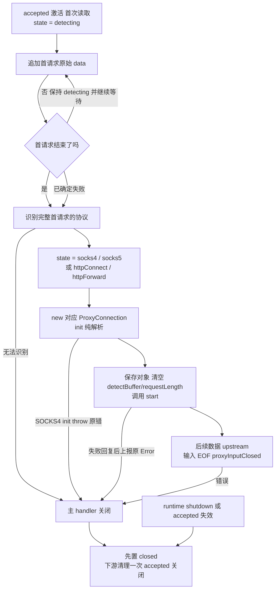

# MagentTCPConnection 产品设计

状态：目标设计，源码尚待迁移。当前源码只识别协议前缀，随后通过首次 `upstream` 交付探测缓冲；
本文改为主 handler 收齐首个协议请求，二级 `init` 解析，安装后显式 `start`，后续字节才交 `upstream`。
这不表示整个 SOCKS5 握手能一次收齐，也不表示请求通过了语义校验。
相关边界：[架构](../ARCHITECTURE.md#ownership-and-lifecycle) ·
[HTTP SPEC](../HTTP_PROXY_SPEC.md) · [主 handler 源码](../../Sources/Connection/MagentTCPConnection.swift) ·
[共享协议源码](../../Sources/Connection/ProxyConnection.swift)。

## Context

`Magent` 为每条 accepted TCP Channel 安装本 handler。它在 detecting 下有界收齐首个请求，
再识别协议、固定协议状态、创建唯一具体 Connection，之后分派字节及 EOF，并拥有 accepted Channel 的最终关闭。
具体 Connection 在初始化阶段解析请求语义，随后负责本地回复和下游资源；Core 选路和创建下游，Wire 编解码。
具体 Connection 遵循统一的 TCPTransfer，按协议范围调用上行和下行方法，推进批次排空、手动续读及 EOF；
主 handler 的成员、状态与协议分派职责不因抽取而扩张。

`detectBuffer` 保存 TCP 字节流中第一个协议请求的完整原始 data：从连接收到的第一个字节开始，
包括协议头、变长字段及该请求的全部 body，不是只保存识别协议所需的前缀。一个请求可以跨多次 TCP read；
TCP 分段、一次 read 返回或 FIN 都不能代替下面的消息结束条件。

下表按四个入口对应的 SPEC 定义字节边界：`B = detectBuffer[0..<writerIndex]`，索引从 0 开始；
`N` 是首请求总字节数（结束位置为不包含端点的偏移 N），`[k]` 表示字段占 k 字节。
`U`、`D` 分别为 USERID、DOMAIN 的字节数，均不含末尾 `00`；`H` 是 HTTP 首个头结束符
`0D 0A 0D 0A`（`\r\n\r\n`）之后的偏移，包含请求行、所有头字段和这 4 个结束字节。

| 协议 / SPEC | 首请求字节布局 | 首请求结尾与精确长度 N |
| --- | --- | --- |
| [SOCKS4 / 4a](../SOCKS4_PROXY_SPEC.md#doc-02-inbound-wire-protocol) | SOCKS4：`04 01 DSTPORT[2] DSTIP[4] USERID[U] 00`。<br/>SOCKS4a：`04 01 DSTPORT[2] 00 00 00 xx USERID[U] 00 DOMAIN[D] 00`，`xx != 00`。 | 从偏移 8 开始找到 USERID 的第一个 `00`。普通 SOCKS4 到该字节结束：`N = 9 + U`，`B[N-1] == 00`。<br/>若 DSTIP 为 `00 00 00 xx` 且 `xx != 00`，继续从 USERID 结束符之后找 DOMAIN 的第一个 `00`：`N = 10 + U + D`，`B[N-1] == 00`。固定头内的 `00` 不作为字段结束符。 |
| [SOCKS5](../SOCKS5_PROXY_SPEC.md#s05) | 首请求是 greeting：`05 NMETHODS[1] METHODS[M]`，其中 `M = UInt8(B[1])`。 | 先收齐前 2 字节，再收 M 个方法字节，`N = 2 + M`；合法 M 为 `1...255`，N 最大为 257。**没有固定结束字节**，METHODS 中的 `00` 是方法值，不是结束符。`M == 0` 在 2 字节处交接失败。CONNECT / UDP ASSOCIATE 命令不属于首请求，必须等 `05 00` 回复写成后再接收。 |
| [HTTP CONNECT](../HTTP_PROXY_SPEC.md#s06) | `CONNECT SP authority SP HTTP/1.x CRLF`，随后是零或多行 `header CRLF`，最后一个 `CRLF`；完整头以 `0D 0A 0D 0A` 结束。 | 无 Content-Length 或 `Content-Length: 0` 时，`N = H`，最后 4 字节为 `0D 0A 0D 0A`；二级 init 还须通过 NIO 的完整 head/end(nil) 校验。非零 Content-Length 或任意 Transfer-Encoding 直接失败，不等待 body。 |
| [HTTP forward](../HTTP_PROXY_SPEC.md#s06) | `METHOD SP request-target SP HTTP/1.x CRLF`，随后是零或多行 `header CRLF`，最后一个 `CRLF`，再接 `BODY[L]`（若有）。 | 无 Content-Length / Transfer-Encoding 时，`L = 0`、`N = H`。唯一合法 Content-Length 的十进制值为 L 时，`N = H + L`，必须收满头结束符之后的 L 个原始字节，由二级 init 通过 NIO head/body/end(nil) 校验。L > 0 时**没有固定结束字节**，body 内的 `00` 或 `\r\n\r\n` 都不终止请求；L = 0 才以头结束符结束。Transfer-Encoding/chunked、重复或非法 Content-Length 均失败。 |

因此，正常首请求收齐时 `B[0..<N]` 就是它的完整 TCP payload；`B.count < N` 继续累计，
`B.count == N` 恰好收齐，`B.count > N` 表示同批还带有首请求之后的额外字节。
交接使用 `B` 的完整原始内容；额外字节保留给二级 init 按严格顺序拒绝，不能裁掉或以后作为合法业务重放。
扫描推进 readerIndex 不改变首请求 data 的范围；不能用剩余的 readableBytes 代替完整 B。
已确认非法、超限或 EOF 截断属于提前失败交接，不再等待完整请求。SOCKS4 的 init 直接抛原错，
由本 handler 关闭 accepted，不安装失败对象或回复；HTTP 仍由二级对象生成适用的失败回复。
未知协议不能猜测回复格式；不完整的 SOCKS5 greeting 在 EOF 时可直接关闭。

本组件不解析业务目标、不选路、不生成 HTTP/SOCKS 回复。`NIOAny` 仍只携带 `ByteBuffer`。
SOCKS5 的专用 `dnsAddress` 固定传 nil，不增加配置透传；UDP DIRECT 域名按
[SOCKS5 DNS 契约](../SOCKS5_PROXY_SPEC.md#s09)失败，不回退其他解析策略。

## Contract

### 受限类型与成员

`MagentTCPConnection.swift` 定义本类及私有 `State`；现有 `ProxyConnection.swift` 定义 ProxyConnection、TCPTransfer 及其固定实现。
两个共享协议的设计契约统一写在本文 Contract 的同级小节，不新增独立设计文档。
主类型限定 **6 个实例成员、6 个状态、8 个方法**：1 个构造、5 个 NIO 回调和 2 个 private 方法。
`requestLength` 只保存 HTTP 头部收齐后计算出的首请求总长度；不保存协议子阶段或持久 decoder。
不新增 Bool、协议工厂、包装 owner、静态存储或其他未声明成员。HTTP 临时结果适配器复用
[HTTP CONNECT 的 codec 契约](HttpConnectConnection-DESIGN.md#共用-http-codec-适配器)。

```swift
internal final class MagentTCPConnection: ChannelInboundHandler, @unchecked Sendable {
    typealias InboundIn = ByteBuffer

    private let serverChannel: Channel
    private let core: MagentCore
    private var detectBuffer: ByteBuffer
    private var state: State = .detecting
    private var proxyConnection: ProxyConnection? = nil
    private var requestLength: Int? = nil
}
```

| 成员 | 初始化及允许修改的入口 | 不变量与生命周期 |
| --- | --- | --- |
| `serverChannel: Channel` | 仅 init 注入。 | 始终为同一 accepted Channel，本组件拥有最终关闭。 |
| `core: MagentCore` | 仅 init 注入。 | 当前 runtime 的 Core，不随 restart 切换，不由本类关闭。 |
| `detectBuffer: ByteBuffer` | init 分配空缓冲；channelRead 从首字节开始追加首请求完整原始 data，并推进扫描游标；install 清空。 | `0..<writerIndex` 保存完整累计 data，收齐边界 N 见 Context 表格；同批尾随字节也保留以供拒绝。不 discardReadBytes；readerIndex 仅作进度，不是请求起点，不能据此丢弃已扫描前缀。交接后不保存业务流量。 |
| `state: State` | 初值 detecting；install 先固定四种协议之一，再构造对象；errorCaught、channelInactive 置 closed。 | 未收齐始终 detecting；六个 case 均不保存额外数据，不承担首请求解析进度。 |
| `proxyConnection: ProxyConnection?` | 初值 nil；install 固定协议状态后，仅构造成功才赋值一次。 | 强持有唯一具体对象，不覆盖、不重置；SOCKS4 构造失败保持 nil，已安装时终态保留引用但不再分派业务。 |
| `requestLength: Int?` | 初值 nil；channelRead 在 HTTP 头完整且定界合法后写入 N；install、errorCaught、channelInactive 清 nil。 | 唯一含义是首请求的总字节数，HTTP 为 H 或 H+L；等待 body 时保持不变。SOCKS4、SOCKS5 不使用，不保存 head、decoder、协议类型或其他阶段数据。 |

构造后所有成员及下游调用均在 accepted EventLoop 串行访问；`@unchecked Sendable` 不开放跨线程写入。
`shutdownFuture` 只在 init 订阅，回调弱引用 accepted 并请求关闭，不另存成员。
临时 collector、context、首包切片、探测返回值及原始 Error 仅在本次同步操作中使用。

### State 定义与转换

```swift
private enum State {
    case detecting
    case socks4
    case socks5
    case httpConnect
    case httpForward
    case closed
}
```

| 状态 | 允许的输入和操作 | 转换 |
| --- | --- | --- |
| detecting | 累计 detectBuffer，按 Context 表格检查首请求是否结束。未结束则继续等待，不创建下游对象。 | 收齐后 detectProxyProtocol 返回具体协议，install 先写入该协议状态，再构造对象；已确定失败按提前失败契约交接。 |
| socks4 / socks5 / httpConnect / httpForward | 对应唯一具体 Connection；后续字节与 EOF 只分派，不再做首请求检测。 | 错误或 accepted 完整失效进入 closed，不退回 detecting、不更换协议。 |
| closed | 不再分派或重复清理，保留必要 NIO 事件传播。 | 终态。 |

`detecting` 同时覆盖首请求的所有分片；没有按协议拆分的 request 或 greeting 状态，各状态也不保存额外数据。
结束判断按原字节选择 Context 中的定界规则，只是本次调用的局部判断，不提前写入协议状态。
HTTP 的总长度用 requestLength 保存，扫描位置使用 detectBuffer.readerIndex；不把已删除的状态搬进容器。

正常顺序是：**判断首请求完整 → 判断协议 → state = 具体协议 → new ProxyConnection**。
install 内从设置 state 到保存对象属于无回调的同步区间：构造纯解析，无 I/O、事件传播或异步任务。
所以这个区间允许 proxyConnection 暂为 nil；构造成功则在 start 前保存引用，SOCKS4 构造抛错则
在同一事件入口的 catch 中直接进入 closed，不能带着未安装对象的协议状态返回或交 EOF。
区间之外协议状态与对象不一致才是内部错误。交接不表示请求有效、建连成功或回复完成。
错误关闭先固定 closed 再清理下游。runtime 关闭仍由 shutdownFuture 请求 accepted 关闭。

<a id="下游-connection-协议proxyconnection"></a>
### 共享协议：ProxyConnection

**定义文件：** [Sources/Connection/ProxyConnection.swift](../../Sources/Connection/ProxyConnection.swift)。
该协议位于独立的 `ProxyConnection.swift` 文件，不定义在 `MagentTCPConnection.swift` 中。

#### 成员契约

无。协议不声明属性要求，不保存实例状态。

#### 非 private 方法

```swift
internal protocol ProxyConnection: AnyObject {
    /// 主 handler 固定协议状态、构造并保存对象、清空首包缓冲后调用一次。
    func start(context: ChannelHandlerContext)

    /// 只交付初始化之后新到达的客户端原字节，由具体对象管理续读。
    func upstream(context: ChannelHandlerContext, data: NIOAny)

    /// accepted 结束或出错时收尾自有下游；不关闭 accepted、不回包、不反向报错。
    func closeConnection(error: Error?)

    /// 所有先到字节已交付后的客户端输入 EOF。
    func proxyInputClosed(context: ChannelHandlerContext)
}
```

#### private 方法

无。

#### 安装与关闭约束

- 同一 EventLoop 内依次完成：固定协议状态 → 取完整首包 → init → 保存对象 → 清空首包缓冲及 requestLength → start。
- init 纯解析、不提交异步工作。SOCKS4 init 声明 throws；失败经 install 原样向上抛出，由事件入口交 errorCaught，不安装对象、不调用 start 或交 EOF、不回复。
- SOCKS5 和 HTTP 的构造及失败回复契约维持各自设计；仅构造成功才保存 owner、清空首包并调用 start，不重复建连或回复。
- 首包不再交 upstream，不用空 ByteBuffer 隐式启动。
- 已知输入 EOF 在 start 后交 proxyInputClosed；已关闭则不交。accepted 已 inactive 时只清理，不构造或回复。
- closeConnection 只收尾下游；正常双向结束或单请求响应排空可在其外请求 accepted.close()，最终关闭归主 handler。
- 下行已排空、accepted 输出已关闭且输入结束直接触发 inactive 时，closeConnection(nil) 可有界等待已有上行写入；完成、失败或 core.defaultTimeout 到期后关闭下游，期间不接新工作或续读。
- nil 不区分正常 FIN 与 runtime 关闭，均按上述窄条件收尾；错误立即中断，UDP 直接释放。
- 主 handler 只清理一次，不等待 Future 或接管写入链。

### 共享传输：TCPTransfer

**目标定义文件：** [Sources/Connection/ProxyConnection.swift](../../Sources/Connection/ProxyConnection.swift)。
`TCPTransfer` 协议及其共享实现均放在此文件，不定义在 `MagentTCPConnection.swift` 中。

一个共享传输协议同时定义上行和下行，通过方法名区分方向；具体 Connection 只遵循这一份传输契约。
本类型只有**抽象方法**和**实现方法**，没有 private 方法。上下行共用 Channel、终态查询和最终收尾入口，
共享实现固定批次排空、手动续读和 EOF 处理，不能由各 Connection 重写。

#### 成员契约

以下四项是对具体 Connection 的唯一属性要求，每项只声明一次；不创建 Transfer 实例或复制状态，不声明 init。
所有访问均在 accepted EventLoop 串行执行。方向由调用的方法确定：上行方法修改上行属性，
下行方法修改下行属性；双向结束判断直接读取同一契约中的另一方向属性。

| 成员 | 用途 | 生命周期 |
| --- | --- | --- |
| `upstreamTransfer: EventLoopFuture<Void>?` | 等待此前接收的客户端数据全部写往下游，防止旧批次完成后提前续读。 | 初值 nil；startUpstream 安装启动屏障，transferUpstream 替换为包含此前工作的本批完成口；仅当前 Future 成功完成才清 nil，关闭时取空。只包含启动和数据处理，不包含 FIN 协调；HTTP forward 的有限请求写入见接入边界。 |
| `downstreamTransfer: EventLoopFuture<Void>?` | 等待成功回复、已收到的下行数据和尾部校验完成，再继续读或结束输出。 | 初值 nil；startDownstream 登记屏障，transferDownstream 追加批次，transferDownstream(nil) 追加一次尾部校验；仅当前 Future 成功完成才清 nil，关闭时取空。不包含 FIN 协调。 |
| `upstreamInputClosed: Bool` | 记录客户端输入 EOF，停止继续向客户端要数据。 | 初值 false；transferUpstream(nil) 首次改 true，不再恢复；此前已接收的批次继续排空。HTTP forward 由具体 EOF 入口记录真实客户端 EOF。 |
| `downstreamInputClosed: Bool` | 记录下游输入 EOF，停止继续向下游要数据。 | 初值 false；transferDownstream(nil) 首次改 true，不再恢复；全部先到数据处理后才校验 Wire 尾部。HTTP forward 由具体响应结束入口记录真实下游 EOF。 |

#### 抽象方法

```swift
internal protocol TCPTransfer: AnyObject, Sendable {
    var upstreamTransfer: EventLoopFuture<Void>? { get set }
    var downstreamTransfer: EventLoopFuture<Void>? { get set }
    var upstreamInputClosed: Bool { get set }
    var downstreamInputClosed: Bool { get set }

    /// 借用已有 Channel 并读取 Connection 现有终态，不新增状态或资源所有者。
    /// proxy 始终为 accepted，终态后仍可借其 EventLoop 创建失败 Future。
    /// wire 在未建连或清理后可为 nil；终态只看 isClosed，不以 Channel.isActive 或单侧 EOF 推断。
    func transferContext() -> (proxy: Channel, wire: Channel?, isClosed: Bool)

    /// 同步编码并提交本批全部下游写入，返回真实写完的 Future。
    /// 不决定何时 read、处理 FIN 或等待对向；同步错误转成同 EventLoop 的原错 Future。
    func writeUpstream(_ data: ByteBuffer) -> EventLoopFuture<Void>

    /// 非 nil：解码、检查协议提交资格并写回客户端，返回全部真实写入的 Future。
    /// nil：只执行 Wire.finishInbound；DIRECT 返回成功，不写客户端、不改变响应提交资格，也不发送 FIN 或关闭连接。
    /// 非 nil 空 ByteBuffer 仍按数据处理；无明文输出返回成功，不冒充 EOF。
    func writeDownstream(_ data: ByteBuffer?) -> EventLoopFuture<Void>

    /// nil：排空条件已由调用者确认，先置终态、清理自有下游，再请求 accepted 关闭。
    /// 非 nil：将原 Error 交 Connection 唯一失败边界，先占终止状态再按协议回复、清理或上报。
    /// 首次调用占有收尾权；后续调用无动作，不覆盖首错，不重新进入传输。
    func finishTransfer(error: Error?)
}
```

- `transferContext()` 的 tuple 只用于当前 EventLoop 操作，不存成员、不跨 Future 捕获；异步回调执行时重新查询。isClosed 直接读取 Connection 既有终态；下游 inactive 后仍需排空时保持 false。isClosed 为 true 时只可创建或完成 Future、释放已有工作，不新增 read、write 或 FIN。
- `writeDownstream(nil)` 由共享实现排在所有下行数据之后调用一次，只提供尾校验结果；它不等待对向、协调 FIN 或决定整体结束。HTTP forward 的具体结束流程也在响应排空后调用它。
- `finishTransfer(error: nil)` 由共享 EOF 流程确认双向排空后调用；HTTP forward 仍由有限请求/响应流程判断。非 nil 错误按原协议资格选择回复，不包装或替换原 Error。
- `finishTransfer(error:)` 是主动收尾边界；`ProxyConnection.closeConnection(error:)` 仍是主 handler 发起的下游清理，不能代替它。终态查询和收尾都复用 Connection 原有状态，不新增标志。

#### 实现方法

四个方法均为 internal：两个启动入口安装屏障，两个传输入口分别处理本方向的数据与 EOF；不设 private 方法。
`data` 非 nil 表示数据，空 ByteBuffer 也属于数据；只有真实 EOF 才显式传 `nil`，不提供默认参数。
返回 Future 始终表示本方向已登记工作排空（下行含尾校验），不表示 FIN 已发送或整个连接已关闭。
以下规则在各方法内执行，不新增 helper 或回调成员；“owner 可用”表示弱引用仍在且当前 `transferContext().isClosed == false`：

- **登记与入口：**均在 accepted EventLoop 执行；nil 成员视为成功 Future。局部 Promise 的 Future 先登记，再安装可能同步完成的回调或执行 I/O。传输入口发现 isClosed 时用 context.proxy.eventLoop 返回关闭错误 Future；已 EOF 后拒绝新数据，重复 nil 返回当前排空 Future，不重复校验或发送 FIN。
- **失败：**回调弱捕获 owner；前驱失败以同一 Error 结束本次 Promise，前驱成功后 owner 消失或已关闭才用关闭错误结束。原 Error 由可用的 owner 原样传给 `finishTransfer(error:)`，包括半关闭失败；必需 Channel 缺失按关闭错误处理。
- **续读与释放：**批次 Future 完成时，Connection 同步释放容量和输入，包括尚未执行 write 的失败批次。成功检查通过 EventLoop 的 `execute` 延后执行；owner 可用且成员仍指向本次 Future 才清空引用，输入未 EOF 才读源 Channel。旧批次不续读，关闭后不新增 Channel/Wire 操作。
- **EOF 收尾：**先交付全部已收数据，再传 nil；本侧排空成功后重读对向 EOF。对向未结束，在当前 EventLoop 回调中立即关闭目标输出；对向也结束，等待此时的对向排空 Future 成功后调用 `finishTransfer(error: nil)`。FIN 协调留在局部回调，不写回成员 Future。

**上行启动：`startUpstream(after:)`**

```swift
/// 登记启动屏障，在协议就绪后取得第一次客户端读许可。
func startUpstream(after ready: EventLoopFuture<Void>)
```

- 上行业务或 EOF 进入前调用一次，将覆盖 Wire 启动和完整成功回复的 `ready` 登记为 `upstreamTransfer`；ready 不含业务链，可与下行共用。
- 注册完成回调；成功后按共用规则清空引用，允许时调用 accepted Channel 的 `read()`。

**下行启动：`startDownstream(after:)`**

```swift
/// 建连前登记启动屏障，协议就绪后处理早到数据或发起首次下游读取。
func startDownstream(after ready: EventLoopFuture<Void>)
```

- 建连及早到数据、EOF 之前调用一次，将覆盖 Wire 启动和适用成功回复的 `ready` 登记为 `downstreamTransfer`；回复直接走启动链，不等待业务链。
- 注册完成回调；成功后按共用规则清空引用，允许时调用下游 Channel 的 `read()`，已接入的早到批次由其最新 Future 负责续读。

**上行输入：`transferUpstream(_:)`**

```swift
/// 非 nil 同步提交数据；nil 记录客户端 EOF。返回本方向排空 Future。
func transferUpstream(_ data: ByteBuffer?) -> EventLoopFuture<Void>
```

- **数据：**Connection 先检查协议资格并预留容量；通过入口检查后保存前驱，登记本批 Promise 并注册完成回调。
- 立即将解包后的 data 交 `writeUpstream`，返回前同步编码并按序提交全部写入；用 `前驱.and(本次写入)` 完成本批，返回本批 Future。释放容量后按共用规则续读，不等前驱才提交，也不重复发送。
- **EOF：**首次 nil 置 `upstreamInputClosed = true`，取得当前 `upstreamTransfer`，注册 EOF 收尾回调并返回该排空 Future；没有待排空工作时使用成功 Future。

**下行输入：`transferDownstream(_:)`**

```swift
/// 非 nil 按序交付数据；nil 记录下游 EOF 并校验尾部。返回本方向排空 Future。
func transferDownstream(_ data: ByteBuffer?) -> EventLoopFuture<Void>
```

- **数据：**Connection 先检查协议资格并预留容量；通过入口检查后保存前驱，登记本批 Promise 并注册完成回调。
- 立即返回本批 Future；前驱成功且 owner 可用后，才将解包后的 data 交 `writeDownstream`，用真实结果完成本批。EOF 前已登记的数据继续交付，write 不等待本批 Future 或再次追加自身，完成后按共用规则释放和续读。
- **EOF：**首次 nil 置 `downstreamInputClosed = true`，保存前驱并先登记尾校验 Promise；注册完成回调，等前驱成功且 owner 可用后调用 `writeDownstream(nil)`，用真实结果完成 Promise。返回尾校验 Future，成功后清空引用并执行 EOF 收尾，不续读；DIRECT 也遵守此顺序。

#### 关键生命周期

- **安装：**Connection 构造时两个 Future 为 nil、两个 EOF 为 false。TCP 隧道的各方向在协议启动边界调用一次 start，同步登记屏障后才能交付该方向业务或 EOF；下行屏障必须先于建连安装。HTTP forward 按下文接入边界处理有限请求。
- **启动等待：**早到下行数据和 EOF 排在 ready 之后，成功回复本身不能排进业务链；启动失败进入唯一失败边界。
- **上行传输：**只接收 NIO 已交付且协议允许的数据，同步编码并提交，使 accepted 随后 inactive 时，合法尾写已进入 NIO。
- **下行传输：**先预留有界容量再登记批次；解码和客户端写入依次等待前驱。闭包暂存的 ByteBuffer 仍计入应用缓冲。
- **排空与续读：**两个方向各自维护排空 Future；仅该方向最新成功回调可以清空引用，且输入未结束时才恢复读取。成员 Future 为 nil 只表示当前无待排空工作；输入参数为 nil 才表示 EOF，空数据或无明文输出不是 EOF。
- **输入结束：**TCP 隧道的真实 EOF 通过本方向 transfer(nil) 交付，只记录一次且不可恢复，先到批次继续排空；下行先登记一次尾校验屏障，再允许回调推进 FIN。HTTP forward 按具体接入边界处理，完整请求写完不代表客户端 EOF。
- **半关闭与整体结束：**本侧排空后，对向未 EOF 则只关闭目标输出；双方都 EOF 则等待双方排空后整体关闭。FIN 协调不写入两个成员 Future，避免互等。
- **终止：**下游 inactive 不等于 Connection 已关闭，此前下行仍须排空；整体关闭先置终态，再结束启动等待与真实 I/O，最后释放引用。迟到回调只收尾已有工作，丢弃 Future 引用不代表取消；HTTP forward 按下文单请求接入边界收尾。

### 共享传输的生命周期与接入

`ProxyConnection.swift` 定义 ProxyConnection、统一的 TCPTransfer 及其固定实现；不新增文件、基类或包装 owner。
本设计把一个类型的抽象方法、实现方法及其具体步骤放在一起；**实现方法由共享实现提供，不是留给 Connection 的接口任务**。
Swift 源码需要用协议扩展承载这些方法体，这是语言语法位置，不是第二套抽象或第二个组件；
不能在 Swift protocol 声明里直接写方法体，也不使用带 fatalError 的空方法模拟抽象类。
同一 Connection 分别遵循 ProxyConnection 和 TCPTransfer；前者承接主 handler 的协议入口，后者统一上下行传输。

#### 抽象与具体的分界

| 公共实现直接完成 | Connection 提供的上下文 |
| --- | --- |
| 登记、聚合和回收本批 Future；只有最新完成才能续读。 | 同步编码或按序解码、本地回复资格、提交实际 Channel 写入。 |
| 调用具体 Channel.read()；记录首次 EOF；等待数据后再校验。 | 借出已有 Channel；执行一次 Wire 尾部校验。 |
| 判断两个 EOF、等待双方排空；选择输出半关闭还是整体关闭。 | 读取现有终态；执行最终关闭或原错误失败路由。 |

- 只有两个排空 Future 和两个输入 EOF 事实。协议不拥有独立存储、运行 Future、待读 Promise、输入队列或线程池。
- 每个属性和抽象方法只在 TCPTransfer 声明一次，Connection 只提供一份对应实现。具体文档须明确其存储或访问器，不能复制标志、隐藏成员或绕过成员上限。
- Channel 只在当前操作借用；Future 来自 accepted EventLoop。该执行环境由 Magent 持有，Connection 负责接入；共享实现不保存 EventLoop 或创建线程。
- 首包解析、选路、Wire.start、协议回复及是否接收业务由 Connection 决定；共享实现不解析本地协议，也不接管连接状态机。
- Connection 在登记批次前检查并预留容量；每批返回 Future 的完成回调同步释放自己的预留。共享续读延后执行，必须晚于这些同步释放回调。
- 排队闭包会暂存尚未处理的 ByteBuffer，仍属于有界应用缓冲；不因没有独立数组而宣称零缓冲。容量覆盖输入、副本和最坏输出，按 [Wire 契约](../WIRES_SPEC.md#缓冲和进度)执行。

#### 排空、FIN 与关闭

- TCP 隧道的两方向屏障先于任何 TCPTransfer 数据或 EOF 入口安装。SOCKS4/CONNECT 在 start 返回前完成；SOCKS5 CONNECT 在完整命令通过后、拨号前完成，握手未完整的 EOF 留在协议失败流程。UDP 不安装。
- 两个成员 Future 只覆盖启动屏障、已接收批次及适用的尾部校验；nil 表示本方向当前没有待排空工作，不表示输入结束。
- 首次 EOF 先记录事实；下行还须先登记尾校验完成口，随后才能执行可能同步完成的回调。
- FIN 协调是首次 EOF 的局部 Future 流程，不放进任一排空成员。这样等待双方数据时不会等到自己或形成两个 FIN 流程互等。
- 单侧 EOF：本侧排空后同步检查对向 EOF；对向未结束就直接调用目标 Channel.close(mode: .output)，保留反向通信。
- 双侧 EOF：公共实现等待两侧数据及下行尾校验都成功，再调用 finishTransfer(error: nil)；不必先人为补发两次半关闭。
- 等待本侧期间可能收到对向 FIN，因此必须在本侧真正排空后重读对向 EOF 和当前排空 Future；不能只用收到第一个 FIN 时的快照。
- 两个 EOF 流程可能同时满足整体关闭条件；finishTransfer 先占终态，另一次回调看到终态即停止，不新增输出已关闭标志。
- NIO 可能在输入已结束时把输出半关闭升级为全关；accepted inactive 的正常尾写例外只等已提交上行写入及 Core timeout。上行因此必须同步提交，不能把合法批次延后到 closed 才编码或写入。
- 下游 channelInactive 不等于 accepted owner 已 closed；Connection 仍须交付此前已收到的下行批次并校验尾部，再结束客户端输出。下游已无法继续写入时，仍按真实写入结果和协议失败边界收敛。
- 关闭必须结束启动等待口和真实 I/O；已排队但尚未提交的批次在前驱结束后看到终态，释放输入并失败。弱引用变 nil 本身不会唤醒 Future。
- 原始失败直接走 finishTransfer(error:)；取消或 owner 消失使用关闭错误，不能伪装为正常 FIN。终态后的关闭操作迟到失败不再次上报。

#### 四个 Connection 的接入边界

| Connection | 公共实现的使用范围 | 保留在具体 Connection 的行为 |
| --- | --- | --- |
| SOCKS4 | 两方向的 start 和 transfer 全部复用，真实 EOF 显式传 nil。 | 完整成功回复控制 ready；成功前拒绝客户端业务，有界接收早到下行。 |
| SOCKS5 TCP CONNECT | 两方向的 start 和 transfer 全部复用，真实 EOF 显式传 nil。 | greeting、command 和完整命令回复；UDP ASSOCIATE 不使用 TCP 传输。 |
| HTTP CONNECT | 两方向的 start 和 transfer 全部复用，真实 EOF 显式传 nil。 | HTTP codec、完整 200 回复及本地错误回复资格。 |
| HTTP forward | 复用下行 start、非 nil transfer 及续读；writeUpstream 提交唯一请求的字节，上行由有限请求写入 Future 跟踪。 | 响应结束时完成尾校验并等请求写完，再整体关闭；不调用 transferDownstream(nil) 的双向 EOF 收尾。 |

HTTP forward 的 writeUpstream 接收具体 Connection 已完成 HTTP 编码的请求字节，执行真实下游写入；不能用空实现满足统一协议。
具体 Connection 先创建覆盖完整请求写入的局部 Promise，将其 Future 登记为 upstreamTransfer，再调用 writeUpstream，
用真实写入结果完成 Promise；由具体 Connection 跟踪完成、释放引用及处理真实客户端 EOF。
不调用面向隧道续读的 startUpstream / transferUpstream。响应结束由具体流程记录下游 EOF、校验尾部并等待请求和响应排空。
HTTP forward 不把“请求写完”记作客户端 FIN，也不为复用接口等待客户端 FIN；后续请求仍由原入口拒绝。
其首个非空响应提交资格仍在 writeDownstream 内决定。有限请求/响应结束与 TCP 双向半关闭的语义不同，不能强行共用结束策略。

本节替代上一版 read/write/finish 全抽象的运行循环。四份具体 Connection 文档仍须逐个对齐属性、抽象方法与既有入口；
尤其不能直接把原 private 属性当作已满足 internal 协议要求。源码尚未迁移，主 handler 及 ProxyConnection 的四个入口不变。

### MagentTCPConnection 方法契约

所有未标 public 的入口均为 internal；下列签名为完整目标契约。除显式 throws/default 外不增加 async 或其他默认参数。

#### 非 private 方法

```swift
internal init(
    _ serverChannel: Channel, core: MagentCore,
    shutdownFuture: EventLoopFuture<Void>
)
func channelActive(context: ChannelHandlerContext)
func channelRead(context: ChannelHandlerContext, data: NIOAny)
func channelInactive(context: ChannelHandlerContext)
func userInboundEventTriggered(context: ChannelHandlerContext, event: Any)
func errorCaught(context: ChannelHandlerContext, error: Error)
```

| 入口 | 调用者与责任 |
| --- | --- |
| init | Magent 安装 handler 时注入依赖、创建空缓冲、订阅 runtime 关闭通知；无网络操作。 |
| channelActive | NIO 回调，传播激活事件并发起首次手动 read。 |
| channelRead | detecting 下有界追加并判断首请求是否结束；不足仅续读，收齐后 try detectProxyProtocol，再 try install。局部 HTTP 头解码结果用于定界；已产生的原 Error 与支持版本一并交 install。所有探测或安装抛错由本入口 catch 后以同一 Error 调用 errorCaught。已安装时只调用 upstream；closed 忽略。 |
| channelInactive | 先置 closed、清空首包缓冲及 requestLength，再以 nil 清理下游一次；重复调用仍传播 inactive。 |
| userInboundEventTriggered | 仅消费 inputClosed：已安装则委派；未齐的已识别 SOCKS4/HTTP 以实际前缀 try install，成功且未关闭才通知 EOF。SOCKS4 构造抛错由本入口 catch 后以同一 Error 调用 errorCaught；HTTP 保留适用的失败回复。未知协议或未齐 greeting 请求关闭。其他事件原样传播。 |
| errorCaught | 固定 closed、清空首包缓冲及 requestLength、以原 Error 清理下游一次，再请求 accepted 关闭；不生成本地回复。 |

Magent 安装前设置 autoRead=false、单批读取和允许远端半关闭。安装前本类续读，start 后读许可归具体对象。
构造仍不接收 dnsAddress；移除 Magent 调用点旧 DNS 参数的源码迁移尚待完成。

#### private 方法

```swift
private func detectProxyProtocol() throws -> State
private func installProxyConnection(
    _ proxy: State, context: ChannelHandlerContext,
    initialError: Error? = nil, initialVersion: HTTPVersion = .http1_1
) throws
```

| 方法 | 调用者、结果与副作用 |
| --- | --- |
| detectProxyProtocol | channelRead 在首请求结束后调用；只读完整原字节并返回四种协议之一。提前失败/EOF 分支也可对实际前缀作相同分类。不修改 state、缓冲或 requestLength，不收齐数据、不建连、不回包；无法分类则抛原错误。 |
| installProxyConnection | channelRead 或 inputClosed 通过 try 调用，入口必须 state == detecting 且对象为 nil，参数为四种具体协议之一。先 state = proxy，再构造；成功才保存唯一对象、清空缓冲与 requestLength，最后 start。SOCKS4 构造失败原样向外抛出，proxyConnection 仍 nil，不继续安装。initialError/initialVersion 只传当前局部 HTTP 头解码的同一原 Error 和支持版本，不能包装。重复安装或非法状态也抛错，统一由外层事件入口路由；本方法不 catch、不自行调用 errorCaught。 |

HTTP 首请求的头部只在完整时局部解码一次。head、错误及版本都在 channelRead 本次调用中使用，
合法时仅把总长度 N 保存为 requestLength，失败时直接分类并交 install，不跨批保存 head。
错误交接版本取本次 codec 结果中受支持的 head.version，否则用 HTTP/1.1；未知协议不猜测回复。
等待 body 时只比较累计长度，不能每收到一个分片就重新解码头部。

| 协议 | 唯一构造调用 |
| --- | --- |
| SOCKS4 | `try Socks4Connection(proxyChannel: serverChannel, core: core, initialData: initialData)` |
| SOCKS5 | `Socks5Connection(proxyChannel: serverChannel, core: core, dnsAddress: nil, initialData: initialData)` |
| CONNECT | `HttpConnectConnection(proxyChannel: serverChannel, core: core, initialData: initialData)` |
| HTTP forward | `HttpForwardConnection(proxyChannel: serverChannel, core: core, initialData: initialData)` |

HTTP 失败交接额外传 `initialError` 和 `initialVersion`，声明以两 HTTP 文档为准。
正常构造不传这两个参数，不由主 handler 构造 HttpProtocol 或解析 NetworkAddress。
SOCKS4 构造抛错时，外层事件入口立即把原 Error 交 errorCaught：由已固定的 socks4 状态进入 closed，
清空 detectBuffer 和 requestLength 并关闭 accepted；没有 Connection 需要 start、EOF 通知或下游清理。

### 首请求收齐约束

- 所有未完成的正常输入都保持 detecting。按原始前缀选择结束判断规则不等于协议分派；
  只有判断完整后，才由 detectProxyProtocol 返回协议并交 install 更新 state。
- SOCKS4 固定头未齐且未确定非法时等待；头齐后 readerIndex 从偏移 8 单调扫描 USERID。
  普通 SOCKS4 到第一个 NUL 完整。4a 的固定头末字节非零，扫描未找到 NUL 时游标前字节也非零；
  找到 USERID 的 NUL 后把 readerIndex 停在其后一字节，即 DOMAIN 起点，前一字节为零。
  以后只检查该起点至多 255 字节的 DOMAIN 窗口，包含最多 254 字节名称及 NUL，不回扫 USERID。
  不保存 domainStart、字段阶段或 Bool；非法命令/端口、域名超限立即按失败交接。
- SOCKS5 直接按前 2 字节得到 N = 2 + NMETHODS，最多等待 257 字节，无需额外长度或阶段成员；
  NMETHODS=0 立即失败。同批余量保留，绝不等后续命令到齐才发方法回复。
- HTTP 方法 token 上限 32 字节。头未齐时用 readerIndex 有界扫描 CRLFCRLF，保留跨批最多 3 字节重叠；
  头齐后固定 readerIndex 为 H，严格校验原始 UTF-8，并对 `0..<H` 调用一次共用 decodeRequest。
  该同步操作使用局部真实 NIO decoder，结束即释放，不伪造 EOF、不构造 HttpProtocol。
  UTF-8 非法或 codec 失败时立即交接失败，不等待 body；head/codec/context 都不跨下一次事件保留。
- HTTP 的长度判断只处理 framing：无 CL/TE 则 N=H；唯一合法 CL=L 则先验证 L<=64KiB-H，再设 N=H+L。
  重复/逗号/非十进制/溢出的 CL、TE/chunked、Expect、Trailer、Upgrade、CONNECT 非零 body 或声明超限，
  立即交子 init 失败，不把额外语义模型放在主类。正常请求将 N 写入 requestLength，之后只等待 writerIndex>=N。
  请求体原字节不需要在主类逐批解码；子 init 对完整交接数据执行唯一完整 NIO 消息校验及模型构造。
  这是受当前单一 Content-Length 范围约束的长度判断，不增加第二套 HTTP 请求行、字段或目标 parser。
- SOCKS4/HTTP 正常首请求上限 64 KiB，HTTP forward 计入头和 body；SOCKS5 greeting 上限 257。
  追加前检查总量；本批首字节已能确定 SOCKS5 时先应用 greeting 限额，不先复制 64 KiB 再裁剪。
  只有确认超限拒绝时，最多保留“上限 + 1 字节”的真实前缀作为证据并停止读取，
  剩余输入可丢弃；子 init 必须先验总量并失败，不能把证据截成合法请求。
  其余交接保留同批所有字节，不丢弃或延后重放。探测尚未分类时也受 64 KiB 限制。

## Core Logic



主流程只有四步：**1. 判断首请求是否结束，未结束继续等待；2. 收齐后识别协议；
3. state 改为具体协议；4. 构造下一层 ProxyConnection 并继续启动。**
之后主 handler 不再探测、解析或缓存业务。SOCKS5 的后续命令始终由已安装的 Socks5Connection 处理。
已确定非法、超限或 EOF 截断继续遵守提前失败契约；它们不是新的状态，也不被视为正常收齐。

### 共享传输流程

逐方法的 `-` 步骤见 [TCPTransfer](#共享传输tcptransfer) 的“实现方法”；本节只串联关键生命周期。

- 协议启动时先安装 ready 屏障，再接收业务或 EOF；启动失败进入具体 Connection 的唯一失败边界。
- 收到业务时登记本批 Future：上行同步编码并提交，下行等待启动屏障和前批后解码、写回客户端。
- 批次真实完成后释放容量；最新 Future 的成功回调在 EventLoop 延后检查，输入未结束才手动 read。
- 收到首次 EOF 时停止本方向续读，保留此前全部批次；下行追加一次 Wire 尾部校验。
- 本侧排空后重读对向 EOF：对向未结束则半关闭目标输出，对向也结束则等待双方排空后整体关闭。
- 任一步失败都保留原 Error；所有完成回调弱捕获 owner，先检查存活与终态，关闭后不提交新的 Channel/Wire 操作。

上行同步提交使 accepted inactive 时合法尾写已进入 NIO；下行顺序等待保证成功回复先于业务输出。
这两种提交时机不能合并。FIN 协调也不写入两个排空成员，避免双向 EOF 互等。

```mermaid
flowchart TD
    A[NIO 交付数据] --> B[登记并聚合本批 Future<br/>上行立即提交 下行按序处理]
    B --> C{本批成功且仍是最新}
    C -->|是 且输入未结束| D[源 Channel.read]
    D --> A
    E[首次输入 EOF] --> F[记录 EOF 停止续读<br/>下行追加 Wire 尾校验]
    F --> G[等待本侧排空]
    G --> H{对向也 EOF 了吗}
    H -->|否| I[目标 Channel 关闭输出<br/>反向仍可通信]
    H -->|是| J[再等对向排空]
    J --> K[调用具体 Connection<br/>完成整体关闭]
    B -->|失败| L[原错误交 finishTransfer(error:)]
    G -->|失败| L
    J -->|失败| L
```

## Corners

| 场景 | 必须保持的行为 |
| --- | --- |
| 首请求逐字节分片 | 始终 detecting，不提前设置协议状态或构造对象；USERID/HTTP 头增量扫描，4a DOMAIN 只检查至多 255 字节窗口。 |
| SOCKS4a USERID 与 DOMAIN 的 NUL 分片 | 分别收齐；不能把 USERID 当目标，也不能把 4a 标记当业务地址。 |
| SOCKS5 客户端等待方法回复才发命令 | 只等 greeting，start 发方法回复；不等待全握手造成互等。 |
| HTTP forward 的 body 晚于头到达 | state 仍为 detecting，只按 requestLength 等待完整 body；不重新解头，收齐后才分类、设状态并构造。 |
| Expect:100-continue 或已确定非法 framing | 提前交接失败，不等待 body、不发 100、不创建下游。 |
| 完整请求与提前业务/第二请求合包 | 原始余量交 init 拒绝；不切包后按合法业务重放。 |
| 恰达上限 / 多一字节 | 前者仍须完整且合法；后者保留超限证据、失败，不无界复制。 |
| 收齐期间 EOF | 已识别 SOCKS4 的 init 抛原错，由主 handler 关闭且不回包；HTTP 仍由失败对象尽力回复；未知协议或未齐 greeting 关闭。 |
| 固定协议状态后 SOCKS4 构造失败 | 原异常经 install 向事件入口传播；对象仍 nil，errorCaught 置 closed、清空首包与 requestLength 并关闭 accepted，不调用 start 或交 EOF。 |
| 构造成功后 start 同步失败 | 构造无回调，保存对象后才能 start；start 失败时主清理能找到正确 owner，首包不再交 upstream。 |
| HTTP 解码原始错误 | 错误实例传二级统一失败边界，再回主关闭；不重解造替代错误。 |
| accepted 半关闭后直接 inactive | 仍只清理一次；二级按共享契约有界收尾已经接收的上行。 |
| restart 与迟到建连回调竞争 | 旧对象关闭并回收迟到下游，不切换 Core、不复活状态。 |

实施验收需覆盖四种首请求分片、同批余量、提前失败、一次 start、读许可和重复清理。
本轮只修订文档；当前 Swift 的前缀交接、旧构造和三个共享入口尚未迁移，不能视作已通过运行验收。

| 共享传输场景 | 必须保持的行为 |
| --- | --- |
| 成功回复慢写而下游先发数据 | 启动屏障先登记，早到批次按容量接到它后面；本地回复本身不等待业务链。 |
| 某方向慢写或同次交付多批 | 聚合所有已登记批次；只有最新批次成功且输入未结束才手动 read，另一方向可独立推进。 |
| NIO EOF 排空多批 | 所有合法批次先登记，之后记录 EOF；按序写完，不能丢弃中间批次或越过尾写发送 FIN。 |
| 空数据或解码暂时无输出 | 非 nil 的空 ByteBuffer 仍是数据批次；只有真实输入 EOF 才传 nil，不从空 payload 推断。 |
| 首请求完整后立即 EOF，或下游早到 EOF | 先登记尚未完成的启动屏障；排空和 FIN 均等待协议启动成功，握手错误走原失败流程。 |
| 同步完成、旧回调或重复 EOF | 先登记完成口，成功检查在 EventLoop 延后执行；旧 Future 不清新引用，重复 nil 返回当前排空 Future，不二次校验或发送 FIN。 |
| 单向 FIN 与对向保持开放 | 本侧排空后只关闭目标输出，反向继续读写，不等待一个尚未发生的对向 EOF。 |
| 双向同时 FIN，双方仍有写入 | 公共实现等待两侧数据及下行尾校验，之后才整体关闭；两个成员不包含 FIN 协调，不能循环互等。 |
| 等待尾写期间才收到对向 FIN | 排空完成后读取最新对向 EOF 和排空屏障，不能用收到第一个 FIN 时的旧判断提前关闭。 |
| Wire 尾部校验失败 | 原错进入唯一失败边界，不伪造正常 FIN，不生成已经失去资格的本地回复。 |
| 关闭、owner 释放或迟到回调 | 先终态并结束启动与 I/O；不续读、不提交排队新写；每批资源仍释放，弱引用不是取消机制。 |
| HTTP forward 响应早于请求写完结束 | 使用有限请求写入屏障收尾，不套双方 EOF 判定，不把请求写成当成客户端 FIN。 |
| accepted 输出已半关，客户端随后以多批数据加 FIN 结束 | 上行每批同步编码并提交，inactive 时全部合法尾写都已进入 NIO；只在已有窄条件下有界等待，不在 closed 后补交排队输入。 |
| 下游完整失效但还有已收到的下行 | 不把下游 inactive 当作 owner closed；此前数据和尾校验仍按序排空后结束客户端输出，实际写错仍按原错误失败。 |
| SOCKS5 UDP ASSOCIATE | 保留数据报语义，不使用 TCP 传输与半关闭流程。 |
