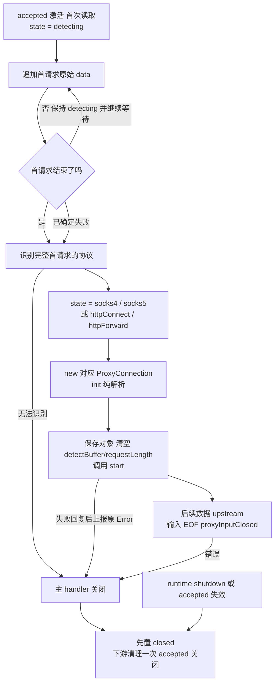

# MagentTCPConnection 产品设计

状态：目标设计，源码尚待迁移。当前源码只识别协议前缀，随后通过首次 `upstream` 交付探测缓冲；
本文改为主 handler 收齐首个协议请求，二级 `init` 解析，安装后显式 `start`，后续字节才交 `upstream`。
这不表示整个 SOCKS5 握手能一次收齐，也不表示请求通过了语义校验。
相关边界：[架构](../ARCHITECTURE.md#ownership-and-lifecycle) ·
[HTTP SPEC](../HTTP_PROXY_SPEC.md) · [主 handler 源码](../../Sources/Connection/MagentTCPConnection.swift) ·
[共享协议源码](../../Sources/Connection/ProxyConnection.swift)。

## Context

`Magent` 为每条 accepted TCP Channel 安装本 handler。它在 detecting 下有界收齐首个请求，
再识别协议、固定协议状态、创建唯一具体 Connection，之后分派字节及 EOF，并拥有 accepted Channel 的最终关闭。
具体 Connection 在初始化阶段解析请求语义，随后负责本地回复和下游资源；Core 选路和创建下游，Wire 编解码。

`detectBuffer` 保存 TCP 字节流中第一个协议请求的完整原始 data：从连接收到的第一个字节开始，
包括协议头、变长字段及该请求的全部 body，不是只保存识别协议所需的前缀。一个请求可以跨多次 TCP read；
TCP 分段、一次 read 返回或 FIN 都不能代替下面的消息结束条件。

下表按四个入口对应的 SPEC 定义字节边界：`B = detectBuffer[0..<writerIndex]`，索引从 0 开始；
`N` 是首请求总字节数（结束位置为不包含端点的偏移 N），`[k]` 表示字段占 k 字节。
`U`、`D` 分别为 USERID、DOMAIN 的字节数，均不含末尾 `00`；`H` 是 HTTP 首个头结束符
`0D 0A 0D 0A`（`\r\n\r\n`）之后的偏移，包含请求行、所有头字段和这 4 个结束字节。

| 协议 / SPEC | 首请求字节布局 | 首请求结尾与精确长度 N |
| --- | --- | --- |
| [SOCKS4 / 4a](../SOCKS4_PROXY_SPEC.md#doc-02-inbound-wire-protocol) | SOCKS4：`04 01 DSTPORT[2] DSTIP[4] USERID[U] 00`。<br/>SOCKS4a：`04 01 DSTPORT[2] 00 00 00 xx USERID[U] 00 DOMAIN[D] 00`，`xx != 00`。 | 从偏移 8 开始找到 USERID 的第一个 `00`。普通 SOCKS4 到该字节结束：`N = 9 + U`，`B[N-1] == 00`。<br/>若 DSTIP 为 `00 00 00 xx` 且 `xx != 00`，继续从 USERID 结束符之后找 DOMAIN 的第一个 `00`：`N = 10 + U + D`，`B[N-1] == 00`。固定头内的 `00` 不作为字段结束符。 |
| [SOCKS5](../SOCKS5_PROXY_SPEC.md#s05) | 首请求是 greeting：`05 NMETHODS[1] METHODS[M]`，其中 `M = UInt8(B[1])`。 | 先收齐前 2 字节，再收 M 个方法字节，`N = 2 + M`；合法 M 为 `1...255`，N 最大为 257。**没有固定结束字节**，METHODS 中的 `00` 是方法值，不是结束符。`M == 0` 在 2 字节处交接失败。CONNECT / UDP ASSOCIATE 命令不属于首请求，必须等 `05 00` 回复写成后再接收。 |
| [HTTP CONNECT](../HTTP_PROXY_SPEC.md#s06) | `CONNECT SP authority SP HTTP/1.x CRLF`，随后是零或多行 `header CRLF`，最后一个 `CRLF`；完整头以 `0D 0A 0D 0A` 结束。 | 无 Content-Length 或 `Content-Length: 0` 时，`N = H`，最后 4 字节为 `0D 0A 0D 0A`；二级 init 还须通过 NIO 的完整 head/end(nil) 校验。非零 Content-Length 或任意 Transfer-Encoding 直接失败，不等待 body。 |
| [HTTP forward](../HTTP_PROXY_SPEC.md#s06) | `METHOD SP request-target SP HTTP/1.x CRLF`，随后是零或多行 `header CRLF`，最后一个 `CRLF`，再接 `BODY[L]`（若有）。 | 无 Content-Length / Transfer-Encoding 时，`L = 0`、`N = H`。唯一合法 Content-Length 的十进制值为 L 时，`N = H + L`，必须收满头结束符之后的 L 个原始字节，由二级 init 通过 NIO head/body/end(nil) 校验。L > 0 时**没有固定结束字节**，body 内的 `00` 或 `\r\n\r\n` 都不终止请求；L = 0 才以头结束符结束。Transfer-Encoding/chunked、重复或非法 Content-Length 均失败。 |

因此，正常首请求收齐时 `B[0..<N]` 就是它的完整 TCP payload；`B.count < N` 继续累计，
`B.count == N` 恰好收齐，`B.count > N` 表示同批还带有首请求之后的额外字节。
交接使用 `B` 的完整原始内容；额外字节保留给二级 init 按严格顺序拒绝，不能裁掉或以后作为合法业务重放。
扫描推进 readerIndex 不改变首请求 data 的范围；不能用剩余的 readableBytes 代替完整 B。
已确认非法、超限或 EOF 截断属于提前失败交接，不再等待完整请求，由二级对象生成适用的失败回复。
未知协议不能猜测回复格式；不完整的 SOCKS5 greeting 在 EOF 时可直接关闭。

本组件不解析业务目标、不选路、不生成 HTTP/SOCKS 回复。`NIOAny` 仍只携带 `ByteBuffer`。
SOCKS5 的专用 `dnsAddress` 固定传 nil，不增加配置透传；UDP DIRECT 域名按
[SOCKS5 DNS 契约](../SOCKS5_PROXY_SPEC.md#s09)失败，不回退其他解析策略。

## Contract

### 受限类型与成员

`MagentTCPConnection.swift` 定义本类及私有 `State`；`ProxyConnection.swift` 独立定义共享协议。
主类型限定 **6 个实例成员、6 个状态、8 个方法**：1 个构造、5 个 NIO 回调和 2 个 private 方法。
`requestLength` 只保存 HTTP 头部收齐后计算出的首请求总长度；不保存协议子阶段或持久 decoder。
不新增 Bool、协议工厂、包装 owner、静态存储或其他未声明成员。HTTP 临时结果适配器复用
[HTTP CONNECT 的 codec 契约](HttpConnectConnection-DESIGN.md#共用-http-codec-适配器)。

```swift
internal final class MagentTCPConnection: ChannelInboundHandler, @unchecked Sendable {
    typealias InboundIn = ByteBuffer

    private let serverChannel: Channel
    private let core: MagentCore
    private var detectBuffer: ByteBuffer
    private var state: State = .detecting
    private var proxyConnection: ProxyConnection? = nil
    private var requestLength: Int? = nil
}
```

| 成员 | 初始化及允许修改的入口 | 不变量与生命周期 |
| --- | --- | --- |
| `serverChannel` | 仅 init 注入。 | 始终为同一 accepted Channel，本组件拥有最终关闭。 |
| `core` | 仅 init 注入。 | 当前 runtime 的 Core，不随 restart 切换，不由本类关闭。 |
| `detectBuffer` | init 分配空缓冲；channelRead 从首字节开始追加首请求完整原始 data，并推进扫描游标；install 清空。 | `0..<writerIndex` 保存完整累计 data，收齐边界 N 见 Context 表格；同批尾随字节也保留以供拒绝。不 discardReadBytes；readerIndex 仅作进度，不是请求起点，不能据此丢弃已扫描前缀。交接后不保存业务流量。 |
| `state` | 初值 detecting；install 先固定四种协议之一，再构造对象；errorCaught/channelInactive 置 closed。 | 未收齐始终 detecting；六个 case 均无关联值，不承担首请求解析进度。 |
| `proxyConnection` | 初值 nil；install 固定协议状态后构造并赋值一次。 | 强持有唯一具体对象，不覆盖、不重置；终态保留引用但不再分派业务。 |
| `requestLength` | 初值 nil；channelRead 在 HTTP 头完整且定界合法后写入 N；install/errorCaught/channelInactive 清 nil。 | 唯一含义是首请求的总字节数，HTTP 为 H 或 H+L；等待 body 时保持不变。SOCKS4/5 不使用，不保存 head、decoder、协议类型或其他阶段数据。 |

构造后所有成员及下游调用均在 accepted EventLoop 串行访问；`@unchecked Sendable` 不开放跨线程写入。
`shutdownFuture` 只在 init 订阅，回调弱引用 accepted 并请求关闭，不另存成员。
临时 collector、context、首包切片、探测返回值及原始 Error 仅在本次同步操作中使用。

### State 定义与转换

```swift
private enum State {
    case detecting
    case socks4
    case socks5
    case httpConnect
    case httpForward
    case closed
}
```

| 状态 | 允许的输入和操作 | 转换 |
| --- | --- | --- |
| detecting | 累计 detectBuffer，按 Context 表格检查首请求是否结束。未结束则继续等待，不创建下游对象。 | 收齐后 detectProxyProtocol 返回具体协议，install 先写入该协议状态，再构造对象；已确定失败按提前失败契约交接。 |
| socks4 / socks5 / httpConnect / httpForward | 对应唯一具体 Connection；后续字节与 EOF 只分派，不再做首请求检测。 | 错误或 accepted 完整失效进入 closed，不退回 detecting、不更换协议。 |
| closed | 不再分派或重复清理，保留必要 NIO 事件传播。 | 终态。 |

`detecting` 同时覆盖首请求的所有分片；没有按协议拆分的 request/greeting 状态，也没有关联值。
结束判断按原字节选择 Context 中的定界规则，只是本次调用的局部判断，不提前写入协议状态。
HTTP 的总长度用 requestLength 保存，扫描位置使用 detectBuffer.readerIndex；不把已删除的状态搬进容器。

正常顺序是：**判断首请求完整 → 判断协议 → state = 具体协议 → new ProxyConnection**。
install 内从设置 state 到保存对象属于无回调的同步区间：构造纯解析，无 I/O、事件传播或异步任务。
所以这个区间允许 proxyConnection 暂为 nil；start 或下一次外部回调到来前，引用必须已经保存。
区间之外协议状态与对象不一致才是内部错误。交接不表示请求有效、建连成功或回复完成。
错误关闭先固定 closed 再清理下游。runtime 关闭仍由 shutdownFuture 请求 accepted 关闭。

<a id="下游-connection-协议proxyconnection"></a>
### 共享协议：ProxyConnection

协议只有以下 **4 个入口**，具体类完整实现，不提供 extension 默认实现。
本次新增 start 是初始化解析与网络启动之间的明确边界，不新增启动结果回调或公共应用 API。

#### 非 private 方法

```swift
internal protocol ProxyConnection: AnyObject {
    /// 主 handler 固定协议状态、构造并保存对象、清空首包缓冲后调用一次。
    func start(context: ChannelHandlerContext)

    /// 只交付初始化之后新到达的客户端原字节，由具体对象管理续读。
    func upstream(context: ChannelHandlerContext, data: NIOAny)

    /// accepted 结束或出错时收尾自有下游；不关闭 accepted、不回包、不反向报错。
    func closeConnection(error: Error?)

    /// 所有先到字节已交付后的客户端输入 EOF。
    func proxyInputClosed(context: ChannelHandlerContext)
}
```

#### private 方法

无。

#### 安装与关闭约束

安装在同一 EventLoop 同步完成：**固定协议状态 → 取完整原字节视图 → init 纯解析 → 保存对象 →
清空首包缓冲及 requestLength → start**。init 不发包、不建连、不续读，也不提交延后启动闭包。
构造不 throws：成功请求或原始错误保存在二级对象的 prepared 阶段，由 start 消费并进入已有失败边界。
不把首包再送一次 upstream，不使用空 ByteBuffer 充当启动信号。start 只消费一次 prepared，不能重复提交回复或建连。

安装前已知输入 EOF 时，在 start 后按序交 proxyInputClosed；若 start 已同步关闭，不再交付。
若当时 accepted 已完整 inactive，则只清理，不构造对象或尝试回复。
`closeConnection` 只收尾下游，最终 accepted 关闭仍由主 handler 收敛。
具体对象可以在正常双向结束/单请求响应排空时请求 accepted.close()，但不在 closeConnection 内这样做。

TCP 隧道下行已排空且 accepted 输出已关闭时，NIO 可能直接发出 channelInactive 而没有 inputClosed。
此时 closeConnection(nil) 只允许此前已经接收的有界上行写入完成，并在失败或 core.defaultTimeout 到期时关闭下游；
不续读、不接新工作。nil 无法区分正常 FIN 与 runtime 关闭，两者在该窄条件下采用相同有界收尾。
错误关闭立即中断，UDP 直接释放。主 handler 只清理一次，不等待 Future 或接管写入链。

### 方法契约

所有未标 public 的入口均为 internal；下列签名为完整目标契约。除显式 throws/default 外不增加 async 或其他默认参数。

#### 非 private 方法

```swift
internal init(
    _ serverChannel: Channel, core: MagentCore,
    shutdownFuture: EventLoopFuture<Void>
)
func channelActive(context: ChannelHandlerContext)
func channelRead(context: ChannelHandlerContext, data: NIOAny)
func channelInactive(context: ChannelHandlerContext)
func userInboundEventTriggered(context: ChannelHandlerContext, event: Any)
func errorCaught(context: ChannelHandlerContext, error: Error)
```

| 入口 | 调用者与责任 |
| --- | --- |
| init | Magent 安装 handler 时注入依赖、创建空缓冲、订阅 runtime 关闭通知；无网络操作。 |
| channelActive | NIO 回调，传播激活事件并发起首次手动 read。 |
| channelRead | detecting 下有界追加并判断首请求是否结束；不足仅续读，收齐后调用 detectProxyProtocol，再 install。局部 HTTP 头解码结果用于定界；已产生的原 Error 与支持版本一并交 install。已安装时只调用 upstream；closed 忽略。未知协议错误交本类 errorCaught。 |
| channelInactive | 先置 closed、清空首包缓冲及 requestLength，再以 nil 清理下游一次；重复调用仍传播 inactive。 |
| userInboundEventTriggered | 仅消费 inputClosed：已安装则委派；未齐的已识别 SOCKS4/HTTP 提前安装失败对象并通知 EOF；未知协议或未齐 greeting 请求关闭。其他事件原样传播。 |
| errorCaught | 固定 closed、清空首包缓冲及 requestLength、以原 Error 清理下游一次，再请求 accepted 关闭；不生成本地回复。 |

Magent 安装前设置 autoRead=false、单批读取和允许远端半关闭。安装前本类续读，start 后读许可归具体对象。
构造仍不接收 dnsAddress；移除 Magent 调用点旧 DNS 参数的源码迁移尚待完成。

#### private 方法

```swift
private func detectProxyProtocol() throws -> State
private func installProxyConnection(
    _ proxy: State, context: ChannelHandlerContext,
    initialError: Error? = nil, initialVersion: HTTPVersion = .http1_1
)
```

| 方法 | 调用者、结果与副作用 |
| --- | --- |
| detectProxyProtocol | channelRead 在首请求结束后调用；只读完整原字节并返回四种协议之一。提前失败/EOF 分支也可对实际前缀作相同分类。不修改 state、缓冲或 requestLength，不收齐数据、不建连、不回包；无法分类则抛原错误。 |
| installProxyConnection | channelRead 或 inputClosed 调用，入口必须 state == detecting 且对象为 nil，参数为四种具体协议之一。先 state = proxy，再构造并保存唯一对象、清空缓冲与 requestLength，最后 start。initialError/initialVersion 只传当前局部 HTTP 头解码的同一原 Error 和支持版本，不能包装。重复安装或非法状态走已有 errorCaught。 |

HTTP 首请求的头部只在完整时局部解码一次。head、错误及版本都在 channelRead 本次调用中使用，
合法时仅把总长度 N 保存为 requestLength，失败时直接分类并交 install，不跨批保存 head。
错误交接版本取本次 codec 结果中受支持的 head.version，否则用 HTTP/1.1；未知协议不猜测回复。
等待 body 时只比较累计长度，不能每收到一个分片就重新解码头部。

| 协议 | 唯一构造调用 |
| --- | --- |
| SOCKS4 | `Socks4Connection(proxyChannel: serverChannel, core: core, initialData: initialData)` |
| SOCKS5 | `Socks5Connection(proxyChannel: serverChannel, core: core, dnsAddress: nil, initialData: initialData)` |
| CONNECT | `HttpConnectConnection(proxyChannel: serverChannel, core: core, initialData: initialData)` |
| HTTP forward | `HttpForwardConnection(proxyChannel: serverChannel, core: core, initialData: initialData)` |

HTTP 失败交接额外传 `initialError` 和 `initialVersion`，声明以两 HTTP 文档为准。
正常构造不传这两个参数，不由主 handler 构造 HttpProtocol 或解析 NetworkAddress。

### 首请求收齐约束

- 所有未完成的正常输入都保持 detecting。按原始前缀选择结束判断规则不等于协议分派；
  只有判断完整后，才由 detectProxyProtocol 返回协议并交 install 更新 state。
- SOCKS4 固定头未齐且未确定非法时等待；头齐后 readerIndex 从偏移 8 单调扫描 USERID。
  普通 SOCKS4 到第一个 NUL 完整。4a 的固定头末字节非零，扫描未找到 NUL 时游标前字节也非零；
  找到 USERID 的 NUL 后把 readerIndex 停在其后一字节，即 DOMAIN 起点，前一字节为零。
  以后只检查该起点至多 255 字节的 DOMAIN 窗口，包含最多 254 字节名称及 NUL，不回扫 USERID。
  不保存 domainStart、字段阶段或 Bool；非法命令/端口、域名超限立即按失败交接。
- SOCKS5 直接按前 2 字节得到 N = 2 + NMETHODS，最多等待 257 字节，无需额外长度或阶段成员；
  NMETHODS=0 立即失败。同批余量保留，绝不等后续命令到齐才发方法回复。
- HTTP 方法 token 上限 32 字节。头未齐时用 readerIndex 有界扫描 CRLFCRLF，保留跨批最多 3 字节重叠；
  头齐后固定 readerIndex 为 H，严格校验原始 UTF-8，并对 `0..<H` 调用一次共用 decodeRequest。
  该同步操作使用局部真实 NIO decoder，结束即释放，不伪造 EOF、不构造 HttpProtocol。
  UTF-8 非法或 codec 失败时立即交接失败，不等待 body；head/codec/context 都不跨下一次事件保留。
- HTTP 的长度判断只处理 framing：无 CL/TE 则 N=H；唯一合法 CL=L 则先验证 L<=64KiB-H，再设 N=H+L。
  重复/逗号/非十进制/溢出的 CL、TE/chunked、Expect、Trailer、Upgrade、CONNECT 非零 body 或声明超限，
  立即交子 init 失败，不把额外语义模型放在主类。正常请求将 N 写入 requestLength，之后只等待 writerIndex>=N。
  请求体原字节不需要在主类逐批解码；子 init 对完整交接数据执行唯一完整 NIO 消息校验及模型构造。
  这是受当前单一 Content-Length 范围约束的长度判断，不增加第二套 HTTP 请求行、字段或目标 parser。
- SOCKS4/HTTP 正常首请求上限 64 KiB，HTTP forward 计入头和 body；SOCKS5 greeting 上限 257。
  追加前检查总量；本批首字节已能确定 SOCKS5 时先应用 greeting 限额，不先复制 64 KiB 再裁剪。
  只有确认超限拒绝时，最多保留“上限 + 1 字节”的真实前缀作为证据并停止读取，
  剩余输入可丢弃；子 init 必须先验总量并失败，不能把证据截成合法请求。
  其余交接保留同批所有字节，不丢弃或延后重放。探测尚未分类时也受 64 KiB 限制。

## Core Logic



主流程只有四步：**1. 判断首请求是否结束，未结束继续等待；2. 收齐后识别协议；
3. state 改为具体协议；4. 构造下一层 ProxyConnection 并继续启动。**
之后主 handler 不再探测、解析或缓存业务。SOCKS5 的后续命令始终由已安装的 Socks5Connection 处理。
已确定非法、超限或 EOF 截断继续遵守提前失败契约；它们不是新的状态，也不被视为正常收齐。

## Corners

| 场景 | 必须保持的行为 |
| --- | --- |
| 首请求逐字节分片 | 始终 detecting，不提前设置协议状态或构造对象；USERID/HTTP 头增量扫描，4a DOMAIN 只检查至多 255 字节窗口。 |
| SOCKS4a USERID 与 DOMAIN 的 NUL 分片 | 分别收齐；不能把 USERID 当目标，也不能把 4a 标记当业务地址。 |
| SOCKS5 客户端等待方法回复才发命令 | 只等 greeting，start 发方法回复；不等待全握手造成互等。 |
| HTTP forward 的 body 晚于头到达 | state 仍为 detecting，只按 requestLength 等待完整 body；不重新解头，收齐后才分类、设状态并构造。 |
| Expect:100-continue 或已确定非法 framing | 提前交接失败，不等待 body、不发 100、不创建下游。 |
| 完整请求与提前业务/第二请求合包 | 原始余量交 init 拒绝；不切包后按合法业务重放。 |
| 恰达上限 / 多一字节 | 前者仍须完整且合法；后者保留超限证据、失败，不无界复制。 |
| 收齐期间 EOF | 已识别 SOCKS4/HTTP 由失败对象尽力回复；未知协议或未齐 greeting 关闭。 |
| 固定协议状态后构造 / start 同步失败 | 构造无回调，保存对象后才能 start；start 失败时主清理能找到正确 owner，首包不再交 upstream。 |
| HTTP 解码原始错误 | 错误实例传二级统一失败边界，再回主关闭；不重解造替代错误。 |
| accepted 半关闭后直接 inactive | 仍只清理一次；二级按共享契约有界收尾已经接收的上行。 |
| restart 与迟到建连回调竞争 | 旧对象关闭并回收迟到下游，不切换 Core、不复活状态。 |

实施验收需覆盖四种首请求分片、同批余量、提前失败、一次 start、读许可和重复清理。
本轮只修订文档；当前 Swift 的前缀交接、旧构造和三个共享入口尚未迁移，不能视作已通过运行验收。
