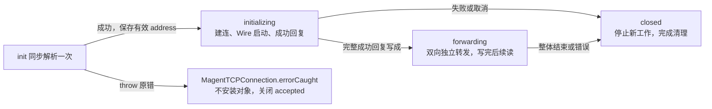

# Socks4Connection Product Design

更新日期：2026-10-16。状态：**三个生命周期阶段、十一个成员、throwing init 与局部启动 Promise 的目标设计；源码与测试待迁移**。
行为基线：[SOCKS4 SPEC](../SOCKS4_PROXY_SPEC.md)、[Wire SPEC](../WIRES_SPEC.md)、
[MODELS SPEC](../MODELS_SPEC.md)；[组件源码](../../Sources/Connection/Socks4Connection.swift)。

## Context

[MagentTCPConnection](MagentTCPConnection-DESIGN.md#core-logic) 在 detecting 中按固定 8 字节、
USERID NUL，以及 SOCKS4a 的 DOMAIN NUL 增量收齐首请求；完整或已确定失败后，识别 SOCKS4 并将主状态置为 socks4，
再把包含同批全部余量的 `initialData` 交构造函数。
本类在 init 中同步完成一次请求解析和严格尾随校验，成功保存非可选目标 address，失败直接 throw 原始错误；
不保存 Result、解析错误、命令或请求字节，构造不选路、不读写网络。
仅构造成功时，主 handler 保存对象并清空自身缓冲，才经 [ProxyConnection](../../Sources/Connection/ProxyConnection.swift)
的 `start(context:)` 启动。`upstream` 此后只接收新字节，不再交首帧或继续补齐请求。
本类负责本地回复、一次 Core 选路、独占 Wire、下游 Channel、流控和正常结束；成功回复完整写成后自行转发。
主 handler 交接后只分派数据，不自行续读；本类借用 accepted Channel 控制读取。
两个方向分别执行“读取一批 → 写入完成 → 继续读取”，不计算速率、不发送阻塞回复，也不增加背压状态。
SOCKS4 请求只在 `init` 解析一次；之后双向业务字节透明转发，不识别应用报文、不等待业务消息完整。
DIRECT 原样传输，PROXY 仅由 Wire 做传输编解码。本类不保留首请求；
下行转发操作可以有界持有等待启动或前批完成的原始输入，这属于 Connection 缓冲，即使字节由 Future 闭包持有。
已提交的写入由 NIO 发送队列保存；不另建线程、DispatchQueue 或第二套业务数据队列。

本类只有三个生命周期阶段：**initializing（尚未建立）→ forwarding（可以双向通信）→ closed（停止工作）**。
选路、建连、Wire 启动及成功回复都属于 initializing 内的一次启动流程；完整成功回复写成后才进入 forwarding。
启动完成前始终停留在 initializing，禁止业务转发；这是状态上的等待，不阻塞 EventLoop，不能调用 wait/get。
Swift init 仍只负责同步解析；异步初始化由 start 的局部 Future 链完成，不保存全局或实例级启动 Promise。
initializing 仅记录回复是否已开始，确保成功回复部分写出后不会再追加失败回复；不为拨号、回复或收尾增加阶段。

构造前已确认首字节为 `04`。非法命令/端口、超限或 EOF 截断是提前交接的失败路径：主 handler
传实际已接收前缀，由构造直接抛原错，经 install 向上交给 MagentTCPConnection 的事件入口，
进入其 errorCaught 并关闭整个 accepted 连接；不保存失败对象、不调用 start、不写 `0x5B`、不创建下游。
正常交接保留同批全部余量；确定超限时仅保留前 64 KiB + 1 字节作为必失败证据，可丢弃本批其余部分。
主 handler 不生成协议回复，也不能把失败输入裁成合法请求。

accepted Channel 归主 handler。正常结束可请求它关闭，错误完成适用的失败回复后交其 pipeline。
`closeConnection(error:)` 只释放或有界收尾下游，不关闭 accepted、不回复、不重复上报。

## Contract

### 类型、十一个成员与持久状态

本类与 `Socks4Command` 留在现有文件。所有成员、Core / Wire 调用及 Future 回调均在 accepted
EventLoop 串行执行；不创建 Task、线程池、运行周期或包装 owner。
本类遵循 [TCPTransfer](MagentTCPConnection-DESIGN.md#共享传输tcptransfer)，共享实现负责排空、续读和 EOF。
四个传输属性直接提供唯一存储，使用 internal 访问级别；其余成员为 private。

```swift
internal final class Socks4Connection: ChannelInboundHandler, ProxyConnection, TCPTransfer, @unchecked Sendable {
    typealias InboundIn = ByteBuffer
    private let proxyChannel: Channel
    private let core: MagentCore
    private let address: NetworkAddress
    private var wireChannel: Channel? = nil
    private var wire: Wire? = nil
    private var state: State = .initializing(replyStarted: false)
    internal var upstreamTransfer: EventLoopFuture<Void>? = nil
    internal var downstreamTransfer: EventLoopFuture<Void>? = nil
    internal var upstreamInputClosed: Bool = false
    internal var downstreamInputClosed: Bool = false
    private var downstreamPendingBytes: Int = 0

    private enum State {
        case initializing(replyStarted: Bool)
        case forwarding
        case closed
    }
}
internal enum Socks4Command: UInt8 {
    case connect = 0x01
    case bind = 0x02
}
```

以上恰好十一个实例成员。两个 EOF 和下行预留各保存一次，不随阶段切换复制或重置。
State 不保存 `Result`、目标、Promise、转发 Future 或容量计数；不声明 `operation`、`startupPromise`、
取消闭包或其他启动控制成员，也不通过静态存储、计算属性、包装类型隐藏这些数据。
局部 Promise 只由创建它的函数及本次有限操作的回调持有，不能成为另一份连接状态或资源 owner。

| 成员 | 用途 | 生命周期 |
| --- | --- | --- |
| `proxyChannel: Channel` | 借用 accepted Channel 发送回复及业务，提供同一 EventLoop。 | init 注入后不替换；最终关闭权属于主 handler。 |
| `core: MagentCore` | 为已验证目标选路、选择 Wire 并创建下游。 | init 注入当前 runtime 的 Core，不替换、不关闭。 |
| `address: NetworkAddress` | init 解析出的唯一业务目标。 | init 通过 try 取得规范化 NetworkAddress 后赋值；实例存在即保证地址有效，后续直接用于选路及 Wire 启动，不再解析或替换。 |
| `wireChannel: Channel?` | 本连接独占的下游 Channel。 | 建连成功且仍 initializing 时保存；迟到成功只关闭。清理先取空再关闭，正常尾写例外可暂留至排空或到期。 |
| `wire: Wire?` | 本连接独占的远端协议编解码状态。 | 一次选路时取得，DIRECT 为 nil；closed 后释放，已提交写入不再需要它。 |
| `state: State` | initializing → forwarding → closed 三个生命周期阶段。 | 初值 initializing(false)，开始成功回复前改为 initializing(true)，完整回复写成才 forwarding；失败或整体结束置 closed，永不恢复。 |
| `upstreamTransfer: EventLoopFuture<Void>?` | 共享实现跟踪启动屏障及全部已接收上行写入。 | init 为 nil；start 同步登记完整 ready Future，之后由 TCPTransfer 聚合、完成和清空；关闭时取空。 |
| `downstreamTransfer: EventLoopFuture<Void>?` | 共享实现跟踪启动、早到下行、业务写入及尾部校验。 | init 为 nil；建连前登记同一个 ready，后续批次按序追加；进入 forwarding 不重建，关闭时取空。 |
| `upstreamInputClosed: Bool` | 客户端真实输入 EOF。 | 初值 false，仅共享 transferUpstream(nil) 首次改 true；不代表下游输出 FIN 已发送，不随阶段切换重置。 |
| `downstreamInputClosed: Bool` | 下游真实输入 EOF。 | 初值 false，仅共享 transferDownstream(nil) 首次改 true；正常 inactive 可以补交一次 nil，不代替 owner 终态。 |
| `downstreamPendingBytes: Int` | 为尚在闭包中等待处理的下行输入、副本、最坏输出和写入预留容量。 | 初值 0；channelRead 在登记批次前增加，每批完成同步扣回自身预留。跨阶段不清零，失败批次也须释放。 |

构造成功即保证 address 有效；构造失败不产生可安装的 Connection，由原始异常直接退出本次构造。
不使用可选地址、占位地址或强制解包，也不声明 initialError。命令在 init 中确认是 CONNECT，
不保留 command，也不在安装下游时重新校验命令。start 只接收构造成功的实例。

### 三个阶段与回复资格

| 状态 | 接收行为 | 转换条件 |
| --- | --- | --- |
| `initializing(replyStarted: false)` | init 已完成解析；start 执行唯一选路、建连及 Wire 启动。客户端额外字节失败，真实 EOF 等待启动，早到下行有界等待 ready。 | 提交八字节成功回复前先将 replyStarted 置 true；任何失败进入 closed，并在写端可用时尽力发送一次 0x5B。 |
| `initializing(replyStarted: true)` | 成功回复尚未完整写成，业务和正常 FIN 仍等待。 | 完整回复写成才 forwarding；错误进入 closed，仅清理并上报，不能追加 0x5B。 |
| `forwarding` | 双向透明转发，共享实现管理批次、背压和方向 EOF。 | 双向排空、不可恢复错误或 owner 关闭进入 closed；单向 FIN 保留反向通信。 |
| `closed` | 不接新输入、续读、建连、Wire 操作或业务写入。 | 终态；已提交写入和已取得资格的失败回复可有限收尾，不能恢复连接。 |

replyStarted 表示成功回复已经提交写入，在调用写入口前置 true，不要求已有字节实际离开 socket。
它是 initializing 内唯一需要跨回调可见的回复事实，不承接构造错误，也不是第四个生命周期阶段。
它不表示启动完成；两个取值都禁止业务转发。否则外部错误入口无法区分“尚在拨号”和“成功回复已部分写出”，
会违反 [SOCKS4 回复规则](../SOCKS4_PROXY_SPEC.md#doc-02-inbound-wire-protocol)。

共享属性和容量满足以下不变量：

- 两个 EOF 只从 false 变 true；入口直接交 transfer(nil)，不能先手动改 Bool，否则共享实现会误判为重复 EOF。
- start 在任何网络操作前安装两个方向的 ready 屏障；initializing 期间两方向都等待完整启动。
- 下行每批先预留再登记，完成时同步释放，包括尚未执行 write 的失败批次；共享续读延后检查，晚于释放。
- 非终态中，downstreamTransfer 为 nil 时预留必须为 0；预留为 0 不能反推 Future 为 nil，启动或零业务尾校验仍可能未完成。
- closed 先取空两个 Future；尚未完成的批次仍通过局部 ready 的结算或真实 I/O 的完成释放，不能把取空引用当作取消。

不保留 upstreamPendingBytes：上行同步编码并提交给 NIO，使用实际待写量和本批局部容量检查。
downstreamPendingBytes 仍必需，因为等待 ready 或前批的输入尚未进入 NIO 发送队列，TCPTransfer 不代算容量。

### 全部方法契约

本类声明 **19 个方法：1 个构造、4 个 ProxyConnection 入口、4 个 NIO 回调、4 个 TCPTransfer 抽象方法实现、6 个 private 方法**。
共享的四个 start/transfer 方法直接采用 [TCPTransfer 固定实现](MagentTCPConnection-DESIGN.md#实现方法)，不在本类重复声明或改写。
构造保持同步并声明 throws，address 是解析后保存的非可选成员，不增加构造调用参数。

#### 非 private 方法

```swift
internal init(proxyChannel: Channel, core: MagentCore, initialData: ByteBuffer) throws
func start(context: ChannelHandlerContext)
func upstream(context: ChannelHandlerContext, data: NIOAny)
func proxyInputClosed(context: ChannelHandlerContext)
func closeConnection(error: Error?)
func channelRead(context: ChannelHandlerContext, data: NIOAny)
func userInboundEventTriggered(context: ChannelHandlerContext, event: Any)
func channelInactive(context: ChannelHandlerContext)
func errorCaught(context: ChannelHandlerContext, error: Error)
func transferContext() -> (proxy: Channel, wire: Channel?, isClosed: Bool)
func writeUpstream(_ data: ByteBuffer) -> EventLoopFuture<Void>
func writeDownstream(_ data: ByteBuffer?) -> EventLoopFuture<Void>
func finishTransfer(error: Error?)
```

| 方法 | 调用者、责任与完成边界 |
| --- | --- |
| `init` | 主 handler 交完整首请求或已知失败的真实前缀。通过 try 同步解析一次并赋值 address；失败原样抛出，由主 handler 终止 accepted 连接。不保存请求、错误或 Result，不创建启动 Promise、不执行 I/O。 |
| `start` | 主 handler 安装构造成功的实例后调用。仅 initializing(false) 且两个 Transfer 均 nil 时启动；先在函数内创建 ready Promise、登记两方向屏障，再串联下游初始化与成功回复。重复调用无动作。 |
| `upstream` | 仅接新字节。initializing 的非空输入交 fail、空输入无动作；forwarding 检查接收资格后交 transferUpstream，空缓冲也是数据；closed 忽略。 |
| `proxyInputClosed` | 非终态直接交 transferUpstream(nil)，由共享实现记录一次 EOF、等待 ready/写入并协调结束；不另写 FIN 流程。 |
| `channelRead` | 非终态先为本批预留下行容量，再交 transferDownstream(data)，在返回 Future 完成时同步释放自身预留；容量失败交 fail，closed 忽略。 |
| `userInboundEventTriggered` | 下游正常 inputClosed 交 transferDownstream(nil)，由共享实现排空、尾校验及协调 FIN；其他事件原样传播。 |
| `channelInactive` | 下游完整失效补交尚未处理的正常 EOF；此前下行仍须排空，之后由共享实现按对向 EOF 决定半关闭或整体结束。已失效下游不再可写，后续上行按真实写入结果失败；closed 仅传播事件。 |
| `errorCaught` | 原错误交 fail；closed 时仅以同一错误调用 closeConnection，立即清理仍保留的下游，不重复回复或上报。 |
| `closeConnection` | 主 owner 或本类失败边界调用。先取得适用的正常尾写 Future，再置 closed、取空传输成员并清理下游。不能访问或完成另一个函数的局部 Promise；启动等待通过真实 I/O、accepted closeFuture 或局部期限结束。 |
| `transferContext` | 供共享实现借用现有 Channel 和读取终态；proxy 永远为 accepted，wire 可 nil，isClosed 只取决于 state 为 closed。 |
| `writeUpstream` | 仅 forwarding，按 NIO 待写量和本批容量同步编码并立即按序提交下游；返回包含全部实际写入的 Future。同步错误转同 EventLoop 的原错 Future，不维护尾链、续读或 FIN。 |
| `writeDownstream` | 非 nil 仅在 ready 之后按序解码一次并实际写 accepted，返回真实写完的 Future；nil 仅调用一次 Wire.finishInbound，DIRECT 成功。空解码不代表 EOF，不维护预留、尾链或续读。 |
| `finishTransfer` | 非 nil 原样交 fail；nil 在共享实现确认双向排空后，先关闭本连接资源，再请求 accepted 关闭。重复调用无动作。 |

#### private 方法

```swift
private static func paserSocks4(_ input: ByteBuffer) throws -> NetworkAddress
private func installWireChannel() throws -> EventLoopFuture<Channel>
private func startTunnel(_ channel: Channel) -> EventLoopFuture<Void>
private func fail(_ error: Error)
private func requestWireChannel(_ data: Data) -> EventLoopFuture<Void>
private func respondProxyChannel(_ data: Data) -> EventLoopFuture<Void>
```

| 方法 | 调用者、责任与完成边界 |
| --- | --- |
| `paserSocks4` | 仅 init 调用。先校验总量、命令、字段、精确边界及同批余量，确认 CONNECT 后只返回规范化目标；截断直接抛原错，不等待更多数据、不访问网络。 |
| `installWireChannel` | start 调用，直接读取 address；唯一选路、选 Wire、建连及启动写，返回本次真实初始化 Future，不通过实例 Promise 交付结果。同步选路错误向 start 传播；异步原错留在返回链。迟到 Channel 只关闭。 |
| `startTunnel` | 下游初始化成功后由 start 调用。先确认仍 initializing(false)，再置 initializing(true)，提交八字节成功回复；真实写成且仍有效才转 forwarding。返回回复完成 Future，不保存 Promise，也不直接 read 或补 EOF。 |
| `requestWireChannel` | 启动写和 writeUpstream 共用的实际下游写入口，返回真实完成 Future；不重复编码、登记业务尾链或取得读许可。 |
| `respondProxyChannel` | 成功/失败回复和 writeDownstream 共用的实际 accepted 写入口，返回真实完成 Future；回复资格由调用者在写前取得，不排到业务等待链后。 |
| `fail` | 构造成功后的唯一首错边界，不接收 init 的解析异常。先从原状态取得失败回复资格，再置 closed、取空传输引用并清理下游。仅原状态 initializing(false) 且 accepted 可写时尽力写一次 0x5B；本次原 Error 由局部有限回复流程持有，完成或到期后只上报一次。其他非终态错误直接上报；closed 不重新竞争首错。 |

相比旧文档，paserSocks4 不再返回长期保存的 command，installWireChannel 改为返回本次 Future，
使 start 能直接串联异步流程。原 outbound/inbound 的链管理由 TCPTransfer 接管，实际编解码和写入归
writeUpstream/writeDownstream；下行预留留在 channelRead。以上是目标接口调整，源码尚未迁移。

### 局部启动流程、回复与错误顺序

启动顺序为：**init 解析并保存 address → start 选路及建连 → Wire 启动写成 → 八字节成功回复写成 → forwarding**。
从构造到完整成功回复始终处于 initializing，业务转发、首次业务读取和正常 FIN 均等待完整启动。
构造函数本身同步返回有效实例或抛原错；只有有效实例进入 start 的函数局部异步流程，禁止阻塞 EventLoop。

start 按以下步骤执行，不把 Promise、取消函数或回调保存为实例/State 参数：

- 检查 initializing(false) 且两方向 Transfer 均 nil，先创建局部 ready Promise<Void>，通过 startUpstream/startDownstream 登记同一个 ready.futureResult。此后重复 start 不再创建启动链。
- 直接使用已解析的非可选 address，调用 installWireChannel，取得建连及 Wire 启动写成的真实 Future；没有解析错误消费分支。
- 下游成功后重查 owner、state 和 accepted 存活；关闭竞争中取得的 Channel 只回收。有效结果才调用 startTunnel，提交回复前将 replyStarted 改 true。
- 成功回复完整写成且仍有效，先进入 forwarding，再成功完成 ready。首次 read、早到数据与已记录 EOF 由共享传输等待 ready 后推进，start 不直接补发读或 FIN。
- 同步/异步启动失败先把同一 Error 交 fail，使其取得唯一终止及回复权，再以该 Error 结束局部 ready。公共传输失败回调因此只释放等待，不能重新回复或替换首因。
- 启动实际结果、accepted closeFuture 和本次启动期限共同结算局部 ready，只有第一个结算生效。owner 关闭时先使连接 closed，再以 connectionClosed 结束等待；这只是内部取消结果，不向已关闭的 owner 重报错误。关闭订阅和期限回调即使发现 owner 消失或已 closed，也必须结束尚未完成的 ready，只跳过再次 fail。state 变为 closed 或成员 Future 置 nil 本身都不能完成 ready。
- 建立期限覆盖建连、Wire 启动及完整成功回复，取 Wire timeout 或 DIRECT 的 Core timeout。超时尚有效时交 fail，并结束 ready；结算后取消本次计时器并释放可释放的启动临时引用。关闭订阅的迟到回调只检查本次已结算结果，不保留输入、Wire 或新的连接 owner。

局部 Promise 的引用、一次结算标记和计时器只服务本次有限初始化，不能存回成员或变成跨批控制容器。
安装在 Channel 上的关闭订阅弱引用 Connection；实际建连成功回调仍负责关闭迟到 Channel，
不能把 ready 的取消当作底层拨号已经取消。
closeFuture 的观察回调不能主动解除，它捕获的已完成局部 Promise 可能保留到 accepted 关闭；
这不代表初始化仍在进行，也不允许额外捕获请求、地址、Wire 或错误历史。

外部错误（例如成功前收到非法客户端字节）直接进入 fail。fail 先固定 closed，清理已取得的下游；
如尚未开始回复，则以局部、受 Core timeout 限制的失败回复流程持有原 Error，随后交 accepted pipeline。
如果成功回复已经开始，只上报原错并由主 handler 关闭 accepted，绝不追加 0x5B。
关闭下游会结束已有真实 I/O；尚在拨号且没有 Channel 时，accepted 的最终关闭或启动期限也会结束局部 ready。
因此等待不是靠访问全局 Promise 取消，也不会无限期挂起。取消带来的关闭错误只唤醒等待者，
首次业务错误的上报仍由首次 fail 的局部流程负责，不能被后来的关闭、写错或超时覆盖。

失败回复完成、失败、owner 关闭及回复期限也只结算本次局部回复一次；写错不覆盖原 Error，owner 已关闭则静默结束。
所有终止路径先更新 state 和资源引用，再执行可重入 Channel 操作。后续 fail 看到 closed 不重新回复或上报。

### 双向传输的接入

两个 Future 只覆盖启动、数据及下行尾校验，EOF/FIN 协调不写入成员；精确步骤采用
[TCPTransfer 的生命周期与接入](MagentTCPConnection-DESIGN.md#共享传输的生命周期与接入)。

| 生命周期时点 | SOCKS4 的接入责任 |
| --- | --- |
| init | 两个 Future 为 nil，两个 EOF 为 false，预留为 0；构造不安装异步工作。 |
| start | 网络操作前，两方向均登记同一个完整启动 ready；成功回复直接沿局部启动链写出，不能等待业务链。 |
| initializing 收到输入 | 客户端新业务拒绝；客户端 EOF 直接 transferUpstream(nil)；下游数据先预留再 transferDownstream(data)，下游 EOF 直接 transferDownstream(nil)。 |
| 完整成功回复写成 | 只转换 forwarding 并完成 ready；不清空已有传输链、EOF 或预留，也不自行续读。 |
| forwarding 数据 | 上行交 transferUpstream，writeUpstream 同步提交；下行交 transferDownstream，writeDownstream 在前驱后解码和写入。 |
| 下行批次完成 | channelRead 注册的完成回调同步释放本批预留；共享实现随后延后检查最新 Future 并续读。 |
| 任一方向 EOF | 只交一次真实 nil，由共享实现记录事实、下行尾校验、排空及选择半关闭/整体结束；不再保留手写 FIN 协调分支。 |
| 关闭 | 先 closed、取空两个 Future；局部启动与真实 I/O 继续以完成/失败/取消结束已有等待，回调不复活成员。 |

Channel.read 只申请读取，nil Future 只表示当前无待排空操作，两者都不代表 EOF。
两个方向独立，不测速、不等待 TCP ACK 或远端应用确认，不创建线程或 Task。
forwarding 的客户端数据和非终态下游数据即使是非 nil 空 ByteBuffer，也按共享数据入口处理；
initializing 的客户端空输入无动作。Wire 没有明文输出时该批正常完成并释放预留，不伪造 EOF。

### 容量、EOF 与清理

使用 [Core Contract](MagentCore-DESIGN.md#contract) 与 [Wire 接口](../WIRES_SPEC.md#抽象接口草图)。
一次选路失败不回退 DIRECT；TCP Channel 共用 accepted EventLoop，每连接独占 Wire。
固定请求上限为 64 KiB，每方向 Connection 预算为 256 KiB，每批原始输入不超过 64 KiB，
单次 Wire 输入不超过 16 KiB；固定回复为 `00 5A 00 00 00 00 00 00` 或 `00 5B 00 00 00 00 00 00`。
这些数值与字节串是方法局部常量，不增加静态成员。
首帧超限交接最多 64 KiB + 1 字节，只作拒绝证据；init 在语义解析或复制请求前检查总量，不保留整批超大输入。

当前 SS 后端编码每个 16 KiB 输入最多 16,452 字节；解码每次最多 32 KiB，整批最多本批长度
加历史 16,383 字节；启动最多 325 字节。继续满足 [Wire 容量契约](../WIRES_SPEC.md#缓冲和进度)，
其中上下行的容量来源不同：

- 上行在 accepted EventLoop 上同步查询 wireChannel 的 `ChannelOptions.bufferedWritableBytes`，
  结合当前方法仍持有的输入、分段临时副本和最坏输出检查容量。每段编码后立即交给 NIO，下一段重新查询；
  不在 Future 回调里保留本批 ByteBuffer 或编码 Data，不另存累计字节数。Channel 选项读取失败沿原错误路径处理，不能当成 0。
- 下行仍使用 downstreamPendingBytes 为整批输入、临时副本、最坏输出和在途写预留空间。
  等待建立屏障或前批写完的原始输入也计入；每批完成释放自己的预留，不因进入 forwarding 而清零。

不足时在追加或调用 Wire 前失败，不先分配再补检查。DIRECT 不预留历史解码余量。
上行各段按 EventLoop 顺序立即编码及提交；任一段失败停止后续段，以原错结束返回 Future，
由共享 finishTransfer 交 fail，不在实际写入方法中另开失败路由。
转发 Future 必须等待所有已提交的真实写入，先登记完成链再执行 I/O，防止同步重入覆盖后继操作。
已登记的本批完成口必须以成功、原始错误或关闭结果结束；同步编码或提交失败也不能留下未完成的 Promise。
NIO 的待写字节只覆盖其发送队列，不代表 Wire 内部内存、临时副本或全部分配；isWritable 也不代替这项容量检查。

正常读许可只在方向队列排空后继续。`autoRead = false` 和 `maxMessagesPerRead = 1` 不能保证
FIN 时只交付一个批次：NIO 的 EOF 收尾可能继续同步排空 socket。
额外上行批次按 NIO 待写量检查后立即提交，额外下行批次按现有预留限制接入；不能因已有转发操作就丢弃合法批次，
也不能把“暂不主动 read”当作不会再有 channelRead 的保证。两个转发 Future 均须包含已接收的合法批次。
旧下行批次只扣减自己的预留；两个方向的旧回调都不能覆盖后继转发操作或提前恢复读取。
启动和回复前不主动读下游，但已交付的原字节仍沿同一下行写链等待；不能以“没发 read”假定其不存在。
下行每批输入及输出只属于该次操作的预留，不因跨越建立阶段而重置或漏计。
这些上限不是进程 RSS 承诺；Wire 内部容量和 EOF 实现仍需其所有者迁移并验收，不能由本文代替。

真实 EOF 直接交共享 transfer(nil)：先记录 EOF，下行追加一次 Wire.finishInbound，全部排在 ready 及先到数据之后。
本侧排空时重读对向 EOF：对向未结束则立即半关闭目标输出，对向已结束则等待双方排空后 finishTransfer(nil)。
FIN 协调不进入两个成员 Future，避免双方互等；具体入口不先修改 EOF、不自行复制该流程。
重复 EOF 不再校验或发送 FIN；网络错误和取消不触发正常尾校验。
下游已完整失效时补交一次下行 EOF，先排空已收到的下行；对向仍开放时只按共享规则结束 accepted 输出。
其后上行写入按真实结果失败，或待双向 EOF 排空后整体结束，不另设强制全关流程，也不从 inactive 推断关闭原因。

所有进入 closed 的路径显式取空 upstreamTransfer 和 downstreamTransfer；状态变更本身不会释放这两个成员。
置 nil 只解除持有，不会取消 Future：启动等待由 start 局部 ready 的真实完成、关闭订阅或期限结束，
Channel 写入由完成或关闭结果结束。没有可供 closeConnection/fail 取出或完成的实例级 Promise。
尚未执行的下行闭包遇到 closed 只释放捕获的输入，不调用 Wire、不提交业务、不回写已移除的状态数据。
迟到完成不得把成员重新赋值、恢复读取或覆盖首次错误。

特殊边界：accepted 已经正常发送输出 FIN，而其输入 FIN 直接触发 inactive、未发送 inputClosed 时，
主 handler 仍调用 `closeConnection(nil)`。只在原状态为 forwarding，且 upstreamInputClosed 为 false、
upstreamTransfer 非 nil、downstreamInputClosed 为 true、downstreamTransfer 为 nil、downstreamPendingBytes 为 0，
并且已提交 accepted 输出 FIN 时，允许已提交的上行写入有限收尾。这表示反向校验与写入已经完成，
客户端输入 EOF 尚未通过单独事件交付，但上行仍有实际写入。
此时先将 upstreamTransfer 保存为本次收尾的局部 Future，再置 closed、取空两个转发成员并释放 Wire，暂留 wireChannel；
局部完成操作只等待此前已经提交给 NIO 的写入，
不再编码或提交新业务。完成、失败或 Core timeout 到达后，先取空 wireChannel 再关闭；计时器不能因 accepted
已经关闭而提前取消。其余正常关闭直接释放下游，清理调用本身不等待。

重复 nil 关闭不新建收尾操作；非 nil 错误即使遇到 closed，也立即取空并关闭仍保留的 wireChannel。
迟到尾写完成或计时器发现引用已取空即无动作。nil 也可能来自运行周期关闭，仍按同一窄条件和期限处理，
不根据 Channel.isActive 猜测关闭原因。closed 表示不再接受工作，不承诺所有底层写入已在同一瞬间完成。

## Core Logic



1. 主 handler 完成分帧或确定失败后，先固定 socks4 状态，再 try 构造；成功才保存对象、清空缓冲并 start。
   构造仅一次完整语义校验，同批余量仍随 initialData 交付；解析异常直接向上抛出，主 handler
   经 errorCaught 清空缓冲并关闭 accepted，不创建失败对象、不写协议回复、不创建下游。
2. initializing 完成唯一启动链，期间拒绝客户端业务、记录 FIN、为早到下行保留有界转发操作。
3. 提交成功回复前记录 replyStarted；完整八字节写成后才进入 forwarding 并完成局部 ready。
   两方向的首次读取、早到下行及 EOF 都由 TCPTransfer 按原有链推进。
4. 主 handler 只分派后续数据。upstreamTransfer 跟踪编码后立即提交的下游写入，
   downstreamTransfer 跟踪等待、解码及客户端写入；当前最新 Future 成功后取空，按 EOF 决定续读来源或结束方向。
   两个方向独立；下一批数据登记新的 Future，业务内容不解析。
5. 整体结束即 closed 并取空两个转发成员；错误回复与规定的已提交尾写由各自有限操作收尾，不增加生命周期阶段。

## Corners

| 场景 | 验收行为 |
| --- | --- |
| 任意分片、64 KiB 边界、SOCKS4a 域名 | 主 handler 增量收齐，USERID 单调扫描、DOMAIN 至多检查 255 字节窗口；本类构造只校验一次，USERID 不认证。 |
| 已识别 04 的非法命令/端口、超限或 EOF 截断 | 主 handler 提前交实际前缀；init 直接 throw 原错，上层 errorCaught 关闭 accepted，不安装对象、不调用 start、不回复、不选路、不建连。 |
| 同批余量、成功前追加业务 | 前者构造解析即失败，后者 upstream 失败；未超限时完整交付余量，不延期当作隧道业务。 |
| 构造解析失败 | 原异常经 install 传播到主 handler 的事件入口；proxyConnection 仍为 nil，首包缓冲与 requestLength 在 errorCaught 清空，协议状态由 socks4 转 closed，后续事件不再尝试构造。 |
| 构造成功、重复 start、安装中的同步回调 | init 已取得有效 address；主保存对象后调用 start，先装两方向屏障再启动网络。重复 start 无动作，不创建第二个局部初始化流程。 |
| 初始化状态等待 | 拨号、Wire 启动和成功回复写入期间都保持 initializing，业务与正常 FIN 等待 ready；EventLoop 继续处理关闭、超时与 I/O，不使用 wait/get。 |
| 成功回复部分写入后失败 | state 仍是 initializing(true)，fail 不再取得 0x5B 资格；原 Error 保留，实际写入或 accepted 关闭结束局部等待。 |
| initializing 期间外部协议错误 | replyStarted=false 时尽力一次 0x5B，true 时仅结束；先置 closed 再清理，首错由本次 fail 局部持有，取消错误不能覆盖它。 |
| 首错、失败回复慢写、下游清理同步重入 | 首错先 closed 并释放下游，重入不再回复或上报；原错只由该次局部失败回复操作在完成或到期后上报。 |
| 目标先发业务、回复慢写、早到多批数据 | downstreamTransfer 的待执行闭包有界持有原始输入，完整成功回复后逐批转发；这是应用缓冲，不等待应用消息边界。 |
| 建立失败或超时 | 屏障失败，等待批次释放且不调用 Wire、不写业务；迟到成功不能重开传输。 |
| owner 在建连或回复期间关闭 | 先 closed 并清理下游；真实 I/O、accepted closeFuture 或有限期限结算局部 ready，等待批次释放，不生成失败回复或反向错误上报。 |
| 完整请求后 FIN、零业务下游 EOF | 建立和完整回复在前；已读原字节只解码一次，EOF 检查不遗漏。 |
| forwarding 中首次客户端 EOF 且无上行转发操作 | proxyInputClosed 直接 transferUpstream(nil)，共享实现在当前回调协调结束；入口不能先设 EOF 或再发送 FIN。 |
| 主 handler 交接后收到业务、任一方向慢写 | 主 handler 只分派、不追加 read；本类等待对应最新写链完成再续读，另一方向仍可传输，无速率参数或阻塞回复。 |
| FIN 排空多批、慢写、双 FIN | 已交付批次的完成结果全部纳入对应 Future 且容量有界；写完成前不误关，不因已有转发操作直接拒绝合法批次。 |
| EOF 排空连续交付上行批次 | 每批在调用 Wire 前检查 NIO 实际待写量及局部容量，立即提交实际写入，不用删除后的上行计数，也不在完成回调中保留原始输入。 |
| 预留为 0 但启动或 EOF 校验未完成 | 保留非 nil 的 downstreamTransfer，不以容量为 0 提前续读、发送 FIN 或完整关闭。 |
| 旧批次完成时已追加新批次 | 下行只释放旧批次自己的预留；两个方向都不清除新转发操作、不覆盖 EOF 参数、不提前续读。 |
| 完成回调同步执行、本批还有未提交分段 | 本批完成口和成员引用先登记；全部分段提交并完成前不续读，不用旧引用覆盖重入产生的新操作。 |
| 转发成员为 nil、来源暂时没有数据 | 已发出的 read 等待 NIO 数据事件，不重复创建 Future、轮询或额外申请读；nil 不等于 EOF。 |
| 下行解码无输出 | 不提交空业务写；完成本批处理、释放预留后，由最新操作入口续读，不停滞也不越过其他待处理批次。 |
| 关闭时仍有未执行的下行批次 | 先 closed 并取空成员，再结束启动或 Channel 操作；待执行闭包释放原始输入，不解码、不写业务、不恢复成员。 |
| 输出 FIN 后 accepted 直接 inactive | 立即 closed，仅规定的已提交上行写入有界完成；不再编码、新提交或续读，不把 nil 当作可靠关闭原因。 |
| 重复 EOF/错误/inactive、restart、迟到建连 | 不重复回复、检查或释放，不恢复状态；迟到 Channel 只关闭。 |

验收沿用 [SOCKS4 向量](../SOCKS4_PROXY_SPEC.md#doc-10-tests-and-acceptance) 与
[Wire 验收](../WIRES_SPEC.md#验收)。本轮未迁移源码或测试，本文不构成构建、网络互操作或上线证明。
