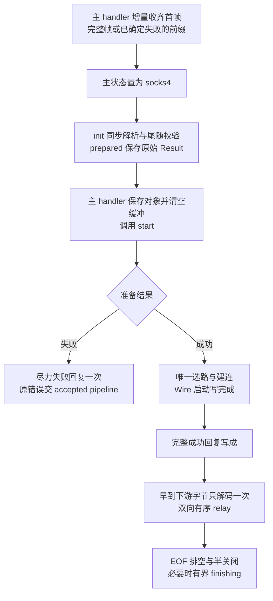

# Socks4Connection Product Design

更新日期：2026-10-13。状态：**主 handler 收齐首帧、六成员子连接的目标设计；本轮仅改文档，源码与测试待迁移**。
行为基线：[SOCKS4 SPEC](../SOCKS4_PROXY_SPEC.md)、[Wire SPEC](../WIRES_SPEC.md)、
[MODELS SPEC](../MODELS_SPEC.md)；[组件源码](../../Sources/Connection/Socks4Connection.swift)。

## Context

[MagentTCPConnection](MagentTCPConnection-DESIGN.md#core-logic) 识别 SOCKS4 后，增量收齐固定 8 字节、
USERID NUL，以及 SOCKS4a 的 DOMAIN NUL；首请求完整或已确定失败后，先将主状态置为 socks4，
再把包含同批全部余量的 `initialData` 交构造函数。
本类同步完成一次请求解析和严格尾随校验，将结果暂存为 prepared；构造不选路、不读写网络。
主 handler 随后保存对象并清空自身缓冲，才经 [ProxyConnection](../../Sources/Connection/ProxyConnection.swift)
的 `start(context:)` 启动。`upstream` 此后只接收新字节，不再交首帧或继续补齐请求。
本类负责本地回复、一次 Core 选路、独占 Wire、下游 Channel、流控和正常结束；成功回复完整写成后自行转发。

构造前已确认首字节为 `04`。非法命令/端口、超限或 EOF 截断是提前交接的失败路径：主 handler
传实际已接收前缀，由构造保存解析错误，安装后的 `start` 尽力写 `0x5B`，不创建下游。
正常交接保留同批全部余量；确定超限时仅保留前 64 KiB + 1 字节作为必失败证据，可丢弃本批其余部分。
主 handler 不生成协议回复，也不能把失败输入裁成合法请求。

accepted Channel 归主 handler。正常结束可请求它关闭，错误完成适用的失败回复后交其 pipeline。
`closeConnection(error:)` 只释放或有界收尾下游，不关闭 accepted、不回复、不重复上报。

## Contract

### 类型、六个成员与持久状态

本类与 `Socks4Command` 留在现有文件。所有成员、Core / Wire 调用及 Future 回调均在 accepted
EventLoop 串行执行；不创建 Task、额外线程池、运行周期或跨组件包装类型。
以下为完整声明；私有枚举均嵌套在本类，`Socks4Command` 为同文件类型。

```swift
internal final class Socks4Connection: ChannelInboundHandler, ProxyConnection, @unchecked Sendable {
    typealias InboundIn = ByteBuffer
    private let proxyChannel: Channel
    private let core: MagentCore
    private var wireChannel: Channel? = nil
    private var wire: Wire? = nil
    private var state: State
    private var buffer: ByteBuffer

    private enum Input {
        case reading
        case ended
    }
    private enum Transfer {
        case reading
        case writing(tail: EventLoopFuture<Void>, pendingBytes: Int)
        case draining(tail: EventLoopFuture<Void>, pendingBytes: Int)
        case ended
    }
    private enum State {
        case prepared(Result<(command: Socks4Command, address: NetworkAddress), Error>)
        case establishing(proxyInput: Input, wireInput: Input)
        case replying(proxyInput: Input, wireInput: Input)
        case relaying(upstream: Transfer, downstream: Transfer)
        case failing
        case finishing(tail: EventLoopFuture<Void>)
        case closed
    }
}
internal enum Socks4Command: UInt8 {
    case connect = 0x01
    case bind = 0x02
}
```

以上恰好六个实例成员，不增加存储或计算属性，不用静态存储、容器、新 owner 或闭包隐藏未声明状态。
State 共七个阶段。关联值也是持久状态，完整范围仅为：待启动的解析结果、建立期间两个输入状态、
转发期间两个方向状态、未完成写链及其容量预留、最终收尾写链。它们表达一次准备结果、EOF 与真实在途工作，不存额外布尔标志。

| 成员 / 关联值 | 初始化、写入入口与生命周期 |
| --- | --- |
| `proxyChannel` / `core` | 构造注入后不替换；accepted 仅借用，Core 固定为所属运行周期。 |
| `wireChannel` / `wire` | `installWireChannel` 唯一选路和建连；DIRECT 的 Wire 为 nil。终态后迟到 Channel 只关闭。清理时释放；`finishing` 保留已有写链需要的资源直到完成或超时。 |
| `buffer` | 构造为空，仅由 `channelRead` 有界保存启动/回复屏障前的原始下游字节；`startTunnel` 顺序交给 `inbound` 后释放。不保存 initialData 或客户端请求，不另存早到明文。 |
| `state` / `prepared` | `init` 以一次 `paserSocks4(initialData)` 的原始 Result 初始化；不抛出、包装或上报解析错误，也不持有请求原字节。`start` 只消费一次，先转换阶段再调用 Core 或错误路径；重复 start 不重放准备结果。 |
| `establishing` / `replying` 的两个 `Input` | `start` 接受成功准备结果后初值均 reading；相应 EOF 入口只改为 ended。前者覆盖建连和启动写；提交成功回复前先改 replying，占用唯一回复资格。 |
| `relaying` 的 `Transfer` | 成功回复后建立。每方向 reading 表示无在途写、输入未结束；writing 保存最新有序尾 Future 和未完成批次的容量预留；EOF 将其改为 draining。预留包括仍持有的输入、临时副本和最坏输出，相应批次完成后释放；全部完成后分别变 reading 或 ended。零业务不伪造写队列。 |
| `failing` / `closed` | `fail` 先进入 failing，屏蔽后续错误和协议操作；原错误由该次回复完成链局部持有。上报前先调用 `closeConnection` 释放下游并置 closed，再把同一 Error 交 accepted pipeline。重复清理无动作。 |
| `finishing.tail` | 仅 `closeConnection(nil)` 的受限正常收尾入口保存已有上行写尾；禁止新读、解码或入队。尾部完成、失败或期限到达后由同一方法清理为 closed。 |

| 状态 | 允许操作与转换 |
| --- | --- |
| `prepared` | 初态，仅保存构造结果；`start` 成功转 establishing、失败交 fail。主 handler 安装后同步 start，之前不分派新字节或 EOF。 |
| `establishing` | 唯一建连与启动写，记录 EOF，拒绝客户端额外字节；`startTunnel` 提交成功回复前转 replying。 |
| `replying` | 等完整成功回复；早到下游原字节仍缓冲，客户端额外字节失败；写成转 relaying。 |
| `relaying` | 双向有序传输与 EOF；正常结束请求 accepted 关闭，窄收尾条件转 finishing，错误交 fail。 |
| `failing` / `finishing` / `closed` | 分别仅完成一次错误路由、已有尾写有界收尾、终态；前两者最终转 closed，不恢复协议处理。 |

`prepared` 不是建连状态；`replying` 提交成功回复，`failing` 封闭错误路由，只有进入前尚未提交成功回复
且已确认 SOCKS4 版本时，才允许该错误链尽力发送一次失败回复。
完整回复前的客户端后续字节始终非法，不能因暂停读取而延期认作隧道载荷。
建立链局部保留目标、启动结果与 Scheduled；尾写和错误回复链局部持有其操作参数，不新增生命周期 owner。
建立期限覆盖建连、启动写、完整成功回复，使用 Wire timeout 或 DIRECT 的 Core timeout；
链完成或 accepted 关闭取消计时器。失败回复与 `finishing` 使用 Core timeout；各自完成后取消。
`finishing` 计时器不能因 accepted 已关闭立即取消。失败回复超时上报原始首因，不改成超时错误。

### 全部方法契约

共享协议新增 [start 入口](MagentTCPConnection-DESIGN.md#下游-connection-协议proxyconnection)，连同原三个入口共四个。
本类精确包含 **17 个方法：1 个构造、4 个共享入口、4 个 NIO 回调、8 个 private 方法**。
构造新增 initialData 且不 throws；删除增量请求方法 `paserLength`，静态 `paserSocks4` 保留一次完整解析。
下游回调来自 SwiftNIO `ChannelInboundHandler`；不增加重载、默认实现或隐式空数据激活。

#### 非 private 方法

```swift
internal init(proxyChannel: Channel, core: MagentCore, initialData: ByteBuffer)
func start(context: ChannelHandlerContext)
func upstream(context: ChannelHandlerContext, data: NIOAny)
func proxyInputClosed(context: ChannelHandlerContext)
func closeConnection(error: Error?)
func channelRead(context: ChannelHandlerContext, data: NIOAny)
func userInboundEventTriggered(context: ChannelHandlerContext, event: Any)
func channelInactive(context: ChannelHandlerContext)
func errorCaught(context: ChannelHandlerContext, error: Error)
```

| 方法 | 调用者、责任与完成边界 |
| --- | --- |
| `init` | 主 handler 先固定 socks4 状态，再传实际完整首帧及同批余量，或已确定失败的前缀；同步解析一次，原始成功/失败存 prepared。buffer 为空，不选路、不生成回复、不注册异步工作。 |
| `start` | 主 handler 已固定协议状态，构造后保存对象并清空缓冲，再调用一次；成功结果先转 establishing 再选路，失败结果交 fail；同步及异步失败保留原 Error。不等待新客户端输入来触发建连。 |
| `upstream` | 主 handler 仅交付构造之后的新字节；建立/回复阶段非空字节立即失败，relay 阶段编码；不累计、补齐或重新解析 SOCKS4 请求。同步失败交 fail。 |
| `proxyInputClosed` | 主 handler 在 start 后交付 EOF；建立/回复阶段记录 EOF；relay 阶段上行 writing → draining、reading → ended，排空后按下述关闭规则执行。 |
| `channelRead` | 屏障前保留原始下游数据；relay 期间交 `inbound`。writing 状态仍接受 NIO 已经交付的合法尾部批次并按预算串联，不以 busy 为错误。 |
| `userInboundEventTriggered` | 记录下游正常 EOF；已读输入完成解码后恰好一次调用 Wire `finishInbound`，然后按方向排空和半关闭；非 EOF 事件传播。 |
| `channelInactive` | 下游完整失效补做未处理的正常 EOF；保留已提交的反向写，排空后请求 accepted 关闭。实际写失败保持原 Error，不把失效等同仍可写的半关闭。 |
| `errorCaught` | 下游原错误交 `fail` 收敛；failing/closed 后不重复。 |
| `closeConnection` | accepted owner 或本类终态链调用；通常先置 closed 再释放资源。唯一可延迟的 nil 收尾见下文；错误、重复事件和迟到回调不能恢复协议状态。 |

#### private 方法

```swift
private static func paserSocks4(_ input: ByteBuffer)
    throws -> (command: Socks4Command, address: NetworkAddress)
private func installWireChannel(command: Socks4Command, address: NetworkAddress) throws
private func startTunnel(_ channel: Channel) -> EventLoopFuture<Void>
private func fail(_ error: Error)
private func outbound(_ data: ByteBuffer) throws
private func inbound(_ data: ByteBuffer) throws
private func requestWireChannel(_ data: Data) -> EventLoopFuture<Void>
private func respondProxyChannel(_ data: Data) -> EventLoopFuture<Void>
```

| 方法 | 调用者、责任与完成边界 |
| --- | --- |
| `paserSocks4` | 仅 init 调用；先检查总量上限，再依可见前缀拒绝非法命令/端口，校验完整边界、目标模型及全部尾随字节；不完整输入直接报截断，不返回等待更多数据。不访问网络或路由。 |
| `installWireChannel` | start 对成功准备结果调用；选路一次，同一 Wire 决定端点、超时、启动与后续编码；串行完成建连、启动写、`startTunnel`。失败保持原 Error，终态迟到 Channel 关闭。 |
| `startTunnel` | 启动写成功后占用成功回复阶段；完整八字节回复写成，再进入 relay、处理 buffer、传播已记录 EOF，最后按方向续读。 |
| `outbound` / `inbound` | 处理完整本批；DIRECT 透传，PROXY 每段仅一次编码/解码；有序写入，预算与所有已排队批次一起计算。空解码不代表 EOF。 |
| `requestWireChannel` / `respondProxyChannel` | 返回实际写完成 Future；relay 期间更新对应 Transfer 的 tail 和 pendingBytes，保持写入顺序。启动和本地回复由建立链串联；这些方法不取得回复资格。 |
| `fail` | 下游原错误或协议边界错误收敛；failing/closed 后不重复，成功回复已经提交则不再补失败回复。 |

### 容量、EOF 与清理

使用 [Core Contract](MagentCore-DESIGN.md#contract) 与 [Wire 接口](../WIRES_SPEC.md#抽象接口草图)。
一次选路失败不回退 DIRECT；TCP Channel 共用 accepted EventLoop，每连接独占 Wire。
固定请求上限为 64 KiB，每方向 Connection 预算为 256 KiB，每批原始输入不超过 64 KiB，
单次 Wire 输入不超过 16 KiB；固定回复为 `00 5A 00 00 00 00 00 00` 或 `00 5B 00 00 00 00 00 00`。
这些数值与字节串是方法局部常量，不增加静态成员。
首帧超限交接最多 64 KiB + 1 字节，只作拒绝证据；init 在语义解析或复制请求前检查总量，不保留整批超大输入。

当前 SS 后端编码每个 16 KiB 输入最多 16,452 字节；解码每次最多 32 KiB，整批最多本批长度
加历史 16,383 字节；启动最多 325 字节。调用前预留整批输入、一个分段临时副本、
最坏输出的 Data / Channel 两份及所有在途写；屏障前 buffer 也计入相同方向预算。
不足时在追加或调用 Wire 前失败，不先分配再补检查。DIRECT 不预留历史解码余量。

正常读许可只在方向队列排空后继续。`autoRead = false` 和 `maxMessagesPerRead = 1` 不能保证
FIN 时只交付一个批次：NIO 的 EOF 收尾可能继续同步排空 socket，所以 Transfer 必须保留尾链与计数。
旧批次完成只扣减自己的预留，不能覆盖后继批次的 tail 或提前恢复读取。
启动和回复前不主动读下游，但早到原字节仍须由 buffer 承接；不能以“没发 read”假定其不存在。
屏障后只解码一次，原 buffer 释放与本批输入/输出的预算归属不得重叠漏计。
这些上限不是进程 RSS 承诺；Wire 内部容量和 EOF 实现仍需其所有者迁移并验收，不能由本文代替。

方向 ended 表示输入已 EOF 且该方向写完；不表示两个 Channel 已关闭。正常 EOF 的 Wire 检查只在
相应输入从未结束转为结束时执行；屏障前记录的 EOF 则在 buffer 解码后、建立 relay 状态时执行。
重复 EOF 不重查；网络错误或取消不能用截断错误覆盖首因。
一方向新进入 ended，另一方向 reading/writing 时，提交该方向对应输出半关闭一次；另一方向
仍 draining 时暂缓，两个方向均 ended 才请求 accepted 完整关闭，避免半关闭升级全关时丢写。
下游已完整失效时，反向尾写排空后请求 accepted 关闭；该事实只表示不可再写，不推断关闭原因。

特殊边界：accepted 已经正常发送输出 FIN，而其输入 FIN 直接触发 inactive、未发送 inputClosed 时，
主 handler 仍调用 `closeConnection(nil)`。仅当原状态为 `relaying(upstream: writing, downstream: ended)`，
即反向 EOF 已校验、反向写已排空并已提交 accepted 输出 FIN，才进入 `finishing(tail:)`；
只允许此前已接收的上行写链继续，完成、失败或 Core timeout 后关闭下游。清理调用本身不等待。
`error != nil` 立即中断；重复 nil 不另起计时器。nil 也可能来自运行周期关闭，既有 API 无法区分原因，
同样受这一窄状态条件和有限期限约束，不能声称根据 `isActive` 推断正常 FIN。

## Core Logic



1. 主 handler 完成分帧或确定失败后，先固定 socks4 状态，再构造、保存对象并清空缓冲，最后 start。
   构造仅一次完整语义校验；同批余量仍随 initialData 交付，错误在 start 时回复，不能先创建下游。
2. start 消费 prepared 一次；Core 选路、建连、Wire 启动写顺序完成。期间新客户端字节失败，FIN 只记录。
3. 完整八字节成功回复写成后，解码有界早到原字节、处理已记录 EOF，开始双向 relay。
4. 两方向分别按“读取 → 编解码 → 有序写成 → 续读”推进；EOF 追加批次仍计入原方向预算。
5. EOF 排空后传播；双向 EOF 协调全关，原错误上报一次。accepted 提前 inactive 的窄尾写条件
   进入 finishing，其余清理直接 closed。

## Corners

| 场景 | 验收行为 |
| --- | --- |
| 任意分片、64 KiB 边界、SOCKS4a 域名 | 主 handler 增量收齐，USERID 单调扫描、DOMAIN 至多检查 255 字节窗口；本类构造只校验一次，USERID 不认证。 |
| 已识别 04 的非法命令/端口、超限或 EOF 截断 | 主 handler 提前交实际前缀；prepared 保存失败，安装后 start 尽力写 0x5B，不补齐、不选路、不建连。 |
| 同批余量、成功前追加业务 | 前者构造解析即失败，后者 upstream 失败；未超限时完整交付余量，不延期当作隧道业务。 |
| 构造解析失败、重复 start、安装中的同步回调 | 主先固定 socks4 状态，再构造、保存对象并清空缓冲，最后 start；构造只存原错误，不触发回调。一次启动/回复，重入能找到同一对象清理。 |
| 成功回复部分写入后失败 | 不补第二个回复，原 Error 保留。 |
| 完整请求后 FIN、零业务下游 EOF | 建立和完整回复在前；已读原字节只解码一次，EOF 检查不遗漏。 |
| FIN 排空多批、慢写、双 FIN | 已交付批次串联且有界；写完成前不误关，不因 writing 直接拒绝合法批次。 |
| 输出 FIN 后 accepted 直接 inactive | 仅规定的上行尾链有界完成；不新读，不新增队列，不把 nil 当作可靠关闭原因。 |
| 重复 EOF/错误/inactive、restart、迟到建连 | 不重复回复、检查或释放，不恢复状态；迟到 Channel 只关闭。 |

验收沿用 [SOCKS4 向量](../SOCKS4_PROXY_SPEC.md#doc-10-tests-and-acceptance) 与
[Wire 验收](../WIRES_SPEC.md#验收)。本轮未迁移源码或测试，本文不构成构建、网络互操作或上线证明。
