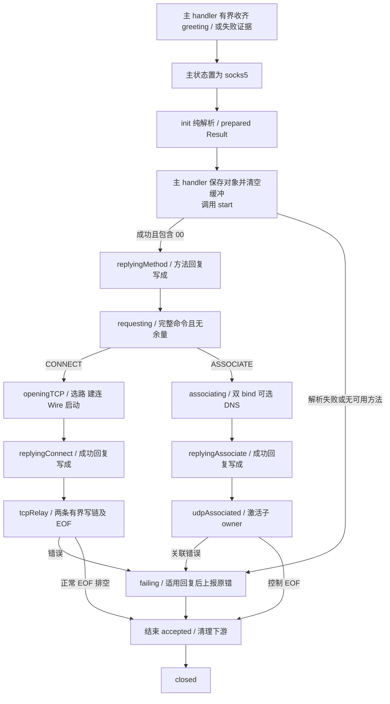

# Socks5Connection Product Design

更新日期：2026-10-13。状态：目标设计；首 greeting 构造解析、显式 start 与六成员契约已修订，Swift 和测试尚待迁移。
行为基线：[SOCKS5 SPEC](../SOCKS5_PROXY_SPEC.md)、[Wire SPEC](../WIRES_SPEC.md)、[MODELS SPEC](../MODELS_SPEC.md)。

## Context

`MagentTCPConnection` 识别 SOCKS5 并收齐首次 greeting，正常交接将累计原始字节及同批全部余量作为
`initialData` 交给唯一 `Socks5Connection` 构造解析；已确认超限时只交最多 258 字节的真实前缀证据，
其余输入可丢弃，不再等待或重放。此例外遵守[主 handler 交接契约](MagentTCPConnection-DESIGN.md)。
首次报文是 `2 + NMETHODS` 字节的 greeting，
不是整个握手；合法客户端会等待 `05 00` 后才发送 CONNECT/ASSOCIATE command，主 handler 不等待 command。
本对象借用 accepted Channel，负责构造纯解析、阶段回复、后续命令增量解析、TCP/UDP 装配及下游生命周期。

`ProxyConnection` 增加唯一共享 `start(context:)`，原有 upstream、EOF、close 三入口签名不变。
主 handler 在 greeting 完整或已确定失败后先置 socks5 状态，再构造、保存对象并清空 detectBuffer，
随后立即调用 start；构造不发回复、不启动网络或隐式任务。
start 消费构造结果，upstream 只接之后的新字节，不重放 initialData，也不用空数据触发启动。
失败由本对象向 accepted pipeline 上报原始错误，由主 handler 关闭 accepted；正常结束可请求其关闭。
`closeConnection(error:)` 仅结束下游，不关闭 accepted 或补发回复。

TCP CONNECT 与 UDP ASSOCIATE 互斥。父对象在 UDP 阶段强持有既有嵌套 `Socks5UDPConnection`；
子对象弱持有父对象，直接处理两个 UDP Channel。所有回调使用 accepted EventLoop，不创建 Task。
当前主 handler 注入 `dnsAddress: nil`。显式 DNS 配置仅用于关联的 UDP DIRECT 域名；无配置时该请求
失败并结束关联，数值 DIRECT 与 PROXY 业务域名不依赖 DNS。不回退系统 Resolver。

## Contract

### 父对象完整类型与成员

约束范围是本类型及其既有嵌套 UDP owner，不增加扩展存储、包装 owner 或 Swift 文件。
父对象恰有下列六个实例成员，无静态存储、计算属性或其他隐藏成员。

```swift
internal final class Socks5Connection: ChannelInboundHandler, ProxyConnection, @unchecked Sendable {
    typealias InboundIn = ByteBuffer

    private enum Transfer {
        case reading
        case writing(tail: EventLoopFuture<Void>, pendingBytes: Int)
        case draining(tail: EventLoopFuture<Void>, pendingBytes: Int)
        case ended
    }
    private enum State {
        case prepared(Result<[UInt8], Error>, dnsAddress: SocketAddress?)
        case replyingMethod(dnsAddress: SocketAddress?)
        case requesting(dnsAddress: SocketAddress?)
        case openingTCP(client: Transfer, remote: Transfer)
        case replyingConnect(client: Transfer, remote: Transfer)
        case tcpRelay(client: Transfer, remote: Transfer)
        case associating(Socks5UDPConnection)
        case replyingAssociate(Socks5UDPConnection)
        case udpAssociated(Socks5UDPConnection)
        case finishing(tail: EventLoopFuture<Void>)
        case failing
        case closed
    }
    private enum HandshakeMessage {
        case request(command: UInt8, address: NetworkAddress)
        case unsupportedCommand(UInt8)
    }

    private let proxyChannel: Channel
    private let core: MagentCore
    private var state: State
    private var buffer: ByteBuffer
    private var wireChannel: Channel? = nil
    private var wire: Wire? = nil
}
```

构造为非 throws 入口：保存两个依赖，先验 initialData 总量；超过 257 字节直接记录失败，
不能截取证据中的合法 greeting。随后纯校验版本、方法计数、完整长度和同批余量，
以 `.prepared(result, dnsAddress: dnsAddress)` 保存方法列表或原始错误；不保存首批原始字节。
`buffer` 用 accepted allocator 创建零容量缓冲，供之后的 command 使用。父 State 共 12 个阶段，
Transfer 共 4 个阶段，无布尔成员。全部可变状态在 accepted EventLoop 访问；可重入 I/O 前先更新状态和引用。

| 阶段 | 允许输入、推进与回复资格 |
| --- | --- |
| `prepared` | 仅 start 消费一次构造 Result；成功且提供 00 时提交方法成功回复，否则交 fail 发送 05 FF。重复 start 无操作，关闭后的 start 不启动。 |
| `replyingMethod` | 暂停 accepted 读取；写成才转 requesting 并续读。已送达的额外字节失败，不再追加方法回复。 |
| `requesting` | 仅增量累计唯一 command；完整无余量后选 openingTCP 或 associating；错误可发一次命令失败回复。 |
| `openingTCP / associating` | 只推进装配；额外客户端字节失败。装配成功进入 replyingConnect / replyingAssociate，提交即占有命令回复权。 |
| `replyingConnect / replyingAssociate` | 写成后分别进入 tcpRelay / udpAssociated；失败不补发结果，UDP 子 owner 仅在成功后激活。 |
| `tcpRelay / udpAssociated` | 按下述 TCP Transfer 或 UDP 生命周期处理后续数据与 EOF；不再解析首 greeting 或发握手回复。 |
| `finishing / failing / closed` | 仅推进既有有界收尾、唯一失败操作或终态；不接收新工作，定义见后文。 |

| 成员/关联值 | 初始化、修改与生命周期约束 |
| --- | --- |
| `proxyChannel/core` | 构造后不变；本对象不拥有 accepted/Core 的最终关闭权。 |
| `state` | init 产生 prepared，start 消费其 Result；`consumeHandshake/writeReply` 推进命令与回复，装配完成进入 TCP/UDP 模式；EOF/写完成推进 Transfer，`fail/closeConnection` 负责终止。 |
| `buffer` | 仅 requesting 累计当前 command，不再增量缓存 greeting。命令完整后清空，TCP 装配和回复期间复用为尚未解码的下游原始字节；进入 relay 后移交一次并清空，不另存解码业务缓存。 |
| `wireChannel/wire` | 仅 TCP 装配设置；一次规则匹配、一次 Wire 选择，同一 Wire 决定端点、超时和编码状态。UDP 阶段恒为 nil。关闭时先取空再关闭资源。 |
| `prepared` 的 Result 与三个握手阶段的 `dnsAddress` | Result 只活到 start 消费，不存为其他成员；DNS 随 prepared/replyingMethod/requesting 移动，选 TCP 后释放，选 UDP 后局部传入子对象装配。 |
| UDP 阶段关联值 | 是本次关联唯一强 owner，不同时保留 TCP 资源。`fail/closeConnection` 取出并关闭，不额外设置 udpConnection 成员。 |
| `Transfer.tail/pendingBytes` | 每方向仅一条串行操作链；预算在接收时预留，在对应操作完成后释放，涵盖等待链中的输入和最坏输出。保留这些必要持久状态，不伪称手动读取能消除在途记录。 |
| `finishing.tail` | accepted 已失效后的唯一既有上行链；只允许该链有界收尾，不能接受新输入或续读。 |

`openingTCP/replyingConnect` 中两个 Transfer 只允许 `reading/ended`，分别表示尚未观察到/已观察到
对应输入 EOF；还未授权业务交付。Wire 的 `start`、启动写、成功回复由顺序 Future 链完成，
不保存 `wireInitialized/startupComplete`、ready Promise 或目标地址副本。

`tcpRelay` 中，`reading` 表示输入开放且无在途操作；`writing` 表示输入开放但操作未全部完成；
EOF 将其转为 `draining`，禁止继续读；链完成并完成该方向 EOF 处理后才能 `ended`。
下游方向的 EOF 处理包含唯一一次 `finishInbound()`；`ended` 仅表示输入 EOF 且该方向已排空，
下游方向还已通过完整性检查，不等价于 FIN 已提交。新进入 ended 时，另一方向若为 reading/writing，
只提交一次对应输出 FIN；若为 draining 则暂缓，待双方 ended 后整体关闭。重复 EOF 不再检查或提交 FIN。
`isActive` 只判断整个 Channel 是否可用，不能代替输入/输出事实；NIO 没有公开的 input/output shutdown 状态属性。

### 父对象完整方法

下列 18 个声明是完整集合：9 个非 private（含构造）、9 个 private；协议回调来自 NIO `ChannelInboundHandler`，
start、upstream、EOF、close 四入口来自 `ProxyConnection`。

#### 非 private 方法

```swift
internal init(
    proxyChannel: Channel, core: MagentCore, dnsAddress: SocketAddress?, initialData: ByteBuffer
)
internal func start(context: ChannelHandlerContext)
internal func upstream(context: ChannelHandlerContext, data: NIOAny)
internal func proxyInputClosed(context: ChannelHandlerContext)
internal func closeConnection(error: Error?)
internal func channelRead(context: ChannelHandlerContext, data: NIOAny)
internal func userInboundEventTriggered(context: ChannelHandlerContext, event: Any)
internal func channelInactive(context: ChannelHandlerContext)
internal func errorCaught(context: ChannelHandlerContext, error: Error)
```

| 调用者 → 方法 | 独占责任 |
| --- | --- |
| 主 handler → init / start | 主先固定 socks5 状态，init 纯解析首批 greeting 并保留成功或原始错误；保存对象并清空缓冲后，唯一 start 消费结果、选择方法回复。构造期间不得出现 I/O 重入。 |
| 主 handler → 其余三入口 | upstream 只交新字节，EOF/close 延续既有生命周期；不得通过首次或空 upstream 代替 start。 |
| NIO → 四个回调 | 下行数据交 relay，正常 EOF 交结束处理，原始错误交 fail；自己的关闭回调不重新报错。 |

#### private 方法

```swift
private func parseHandshake(_ input: ByteBuffer)
    throws -> (message: HandshakeMessage?, consumed: Int, minimumAdditional: Int)
private func consumeHandshake() throws
private func openTCP(target: NetworkAddress) -> EventLoopFuture<Void>
private func openAssociation(hint: SocketAddress) -> EventLoopFuture<SocketAddress>
private func writeReply(_ data: ByteBuffer) -> EventLoopFuture<Void>
private func relayClient(_ data: ByteBuffer) throws
private func relayRemote(_ data: ByteBuffer) throws
private func finishRemoteInput() throws
private func fail(_ error: Error, replyCode: UInt8? = nil)
```

| 调用者 → 方法 | 独占责任 |
| --- | --- |
| `upstream` → `parseHandshake/consumeHandshake` | 仅解析 requesting 阶段 command 的不足量和边界，推进唯一命令；不再处理 greeting。完整消息后余量拒绝，不跨阶段保存。 |
| `consumeHandshake` → `openTCP/openAssociation` | 真实装配 Future；拨号/首次 bind 之前及每次完成均检查终态与 accepted 活性，迟到资源立即独立关闭。 |
| `start / consumeHandshake` → `writeReply` | 分别提交方法/命令成功回复；先进入相应 replying 阶段，写成才能继续，开始写即占有该阶段回复权。 |
| 输入/完成回调 → `relayClient/relayRemote/finishRemoteInput` | 有界、按序转换与写入；以现有 tail 衔接 EOF，当前 tail 完成才续读或传播 FIN。 |
| 最高拥有边界 → `fail` | 根据失败前 phase 决定唯一适用回复；unsupportedCommand 在解析边界显式传 `replyCode: 0x07`，无需长期保存命令或解析错误文本。 |

辅助装配通过 Future 组合原样传播错误，不在 helper 捕获并改名或路由。
`fail` 先取空自有下游资源并置 `failing`，关闭这些资源后再尽力回复；只有 prepared 可发 `05 FF`，
requesting/openingTCP/associating 可发命令失败回复。replying 或转发阶段不再追加结果。
首因只由这次失败操作的局部完成链持有；写完、写失败、期限三路仅一条可将 failing 推向 closed 并
上报原错。`closeConnection` 可提前关闭并使迟到完成无操作，不保存 firstError/errorReported/didCleanUp。
`fail` 是本次明确修订的私有签名；其可选回复码仅供当前解析失败使用，不开放跨组件 API。

### UDP 子对象完整契约

既有嵌套 owner 恰有六个实例成员；删除重复 `core`，通过存活的 owner 借用同一 runtime。
来源提示与固定来源互斥，随 UDP 阶段移动，不把旧的来源、激活和关闭布尔量装进结构体。

```swift
private final class Socks5UDPConnection: ChannelInboundHandler, @unchecked Sendable {
    typealias InboundIn = AddressedEnvelope<ByteBuffer>
    private enum State {
        case preparing(hint: SocketAddress)
        case ready(hint: SocketAddress)
        case awaitingClient(hint: SocketAddress)
        case forwarding(client: SocketAddress)
        case closed
    }
    private weak var owner: Socks5Connection?
    private var state: State
    private var ipv4Channel: Channel? = nil
    private var ipv6Channel: Channel? = nil
    private var dnsClient: DNSClient? = nil
    private var backendWires: [SocketAddress: Wire?] = [:]
}
```

#### 非 private 方法

以下方法均属于 `Socks5UDPConnection`；按方法自身声明分组，类型仍是父对象内的 private 类型。

```swift
init(owner: Socks5Connection, hint: SocketAddress)
func openAssociation(dnsAddress: SocketAddress?) -> EventLoopFuture<SocketAddress>
func activate()
func closeConnection()
func channelRead(context: ChannelHandlerContext, data: NIOAny)
func channelInactive(context: ChannelHandlerContext)
func errorCaught(context: ChannelHandlerContext, error: Error)
```

#### private 方法

```swift
private func handleDatagram(_ packet: AddressedEnvelope<ByteBuffer>, channel: Channel)
    -> EventLoopFuture<Void>
private static func decodeDatagram(_ data: ByteBuffer)
    throws -> (target: NetworkAddress, payload: ByteBuffer)
private static func encodeDatagram(payload: ByteBuffer, source: NetworkAddress.Address) throws
    -> ByteBuffer
```

#### 生命周期约束

构造置 `.preparing(hint: hint)`，其余初值如声明，不联网。父已将 hint 与 TCP peer 比较并规范化。
父保存子对象后调用唯一装配入口，局部借用 Core/控制 Channel；逐个保存 IPv4、IPv6 bind 和可选 DNS。
全部成功后进入 ready，返回实际 IPv4 BND；父成功回复写成才 `activate` 至 awaitingClient 并各 read 一次。
第一个匹配 hint 且完整合法的包才转为 forwarding 并固定来源；非法包不抢占，之后不重新绑定。

backendWires 最多 1024 项，保存实际后端与对应 Wire；有 key 且 value=nil 表示 DIRECT。
禁止来源/后端冲突和覆盖已有不同归属。没有 DNS 结果缓存、载荷队列、每包 owner 或持久操作 Future。
每个 UDP Channel 一次包操作完成才续读；借用 Core 与 `NIOLoopBound` 包裹的单包 Wire 仅活到本包链完成。
两个 Channel 在同一 EventLoop 串行修改登记，关闭后的 DNS 完成不登记、不发送、不续读。

`closeConnection` 先 closed，取空三个资源、清空登记，再关闭；弱 owner 不延长父生命周期。
装配 bind/DNS 操作失败仅经其 Future 返回原错；已建资源的独立 error/inactive（包括 preparing）
则关闭子对象并立即 owner.fail，以免被随后 connectionClosed/超时替换首因，父终态负责去重。
单包格式/编码/容量/未知来源或 writeMessageTooLarge 仅丢包；路由、DNS、不可恢复资源错误结束关联。

## Core Logic



主 handler 只判断首 greeting 是否已可交接；NMETHODS=0 或已识别的致命首包前缀也立即交构造，
由 initialData 本身确定原始错误，不增加 error 参数。完整首报文非法、超限或同批存在额外字节均保存失败 Result，
start 统一决定方法失败回复；主 handler 不选择方法或代写 05 FF。greeting 未齐就 EOF 可直接关闭且不回包。
方法回复写成后才进入 requesting 并续读 command，不能提前建连或缓存首批附带 command。
阶段本身决定回复资格，替代 replyStarted、acceptedCommand、startupComplete 等独立事实。
完成 CONNECT 后的 FIN 可等待建连和完整成功回复；建连/回复期间的额外客户端字节仍严格拒绝。
下游先发数据只保留原始字节，回复完成后顺序解码一次，零业务 EOF 也经过同一成功屏障。

通常按 read → 当前方向写链完成 → read 运转。但 NIO 在 FIN 通知后可能强制连续排空输入，
`autoRead=false/maxMessagesPerRead=1` 不保证只存在一笔在途操作：额外批次必须先预留预算，再接到同一 tail。
EOF 将本方向封闭，不能越过已接收的数据；两向输入均结束时，两条 tail 完成后才能执行会导致完整关闭的动作。

NIO 在 output 已关闭后收到 input EOF，可能直接 channelInactive 而不再发送 inputClosed。
若 accepted 已失效、主 handler 调用 closeConnection(nil)，且恰处于
`tcpRelay(client: writing, remote: ended)`，则进入 finishing；该组合证明反向曾在上行输入仍开放时
进入 ended 并提交 accepted 输出 FIN。禁止新入口，只让既有上行 tail 继续提交此前排队的写入。
链完成/失败或 core.defaultTimeout 到期的局部回调直接取空并关闭下游、置 closed，不再调用
closeConnection(nil)，避免被 finishing 的重复调用守卫吞掉清理。运行周期关闭也可能传 nil，
不能声称能识别原因；本窄状态一律允许有界收尾。非 nil 错误立即终止；其他关闭立即清理。
下游同类 full inactive 由本对象回调按已有 Transfer 事实补接 EOF 检查/排空，不能继续承接上行写。

## Corners

- 首 greeting 长度为 2 + NMETHODS，最大 257 字节；NMETHODS=0 交给 start 发送 05 FF，不等待不存在的方法字节。
  greeting 分片只由主 handler 收集；未超限时同批余量完整交构造并拒绝，不能截去余量后误发成功。
  已确认总量超过 257 时最多交 258 字节的真实前缀，init 先验总量失败；该拒绝路径才允许丢弃剩余字节。
  greeting 未齐即 EOF 时主 handler 直接关闭、不构造失败对象、不回包；不创建出站。
- 构造不 throws、不回复、不拨号、不 read，也不安排隐式启动；失败 Result 经 start 交 fail，保留原错。
  关闭先于 start、重复 start、方法回复同步失败均不能重入安装或重复回复；upstream 不重放首批或承担隐式激活。
- 方法回复后 command 最大 262 字节，添加前检查；严格拒绝完整命令余量、建立期间或成功回复前业务。
- TCP 单批最多 64 KiB，Wire 分片输入最多 16 KiB；支持的 Wire 装配需满足 start≤325、encode≤16452、
  decode≤32768 字节，单批解码最多本批长度加历史 16383 字节。每方向 256 KiB 预算按“保留输入 +
  分片副本 + 两倍最坏输出”预留；pendingBytes 包含尚在 tail 等待的预留，完成才释放，追加前检查。
  启动期原始 buffer 最多 64 KiB，并计入该方向预算；固定数字只在方法局部使用，无静态限额成员。
- Transfer 的 tail 身份及预算共同确定最终完成点，旧的批次完成不能误将仍有后继操作的方向改成 reading。
  正常 EOF 的完整性操作只追加一次；draining 完成即转 ended。另一方向仍 draining 时仅暂缓 FIN，
  其后双方 ended 整体关闭，不把已排空的方向留在 draining 或重复检查/提交 FIN。
- TCP 建连/启动及成功回复使用选定 Wire.getTimeout()，DIRECT 用 core.defaultTimeout；UDP 装配、方法回复、
  尽力失败回复用 Core 默认期限。局部 Scheduled 隶属于本次操作，完成/关闭取消，不新增握手或空闲配置。
  finishing 自有期限在 accepted 失效之后开始，不能被已经完成的 accepted.closeFuture 立即取消。
- UDP 完整包最多 65507，接收能力 65535 字节；超限/FRAG/未知后端丢包，不能截断后转发；零载荷有效。
  控制 EOF、额外控制字节、空登记下关闭和资源失败均释放两个 UDP Channel 与 DNS，不关闭其他关联 Wire。
- 迁移验收覆盖所有分片、阶段回复、FIN 强制多批排空、两向交错 FIN、先关闭输出再收 FIN、迟到资源和容量。
  对照 [SOCKS5 验收表](../SOCKS5_PROXY_SPEC.md#s26)；本轮仅改文档，旧源码和此前测试结果不证明本目标已实现。
  Wire 固定容量/完整性及共享 main 的正常关闭收尾约束须分别验收，不能用替身或仅编译通过代替。
